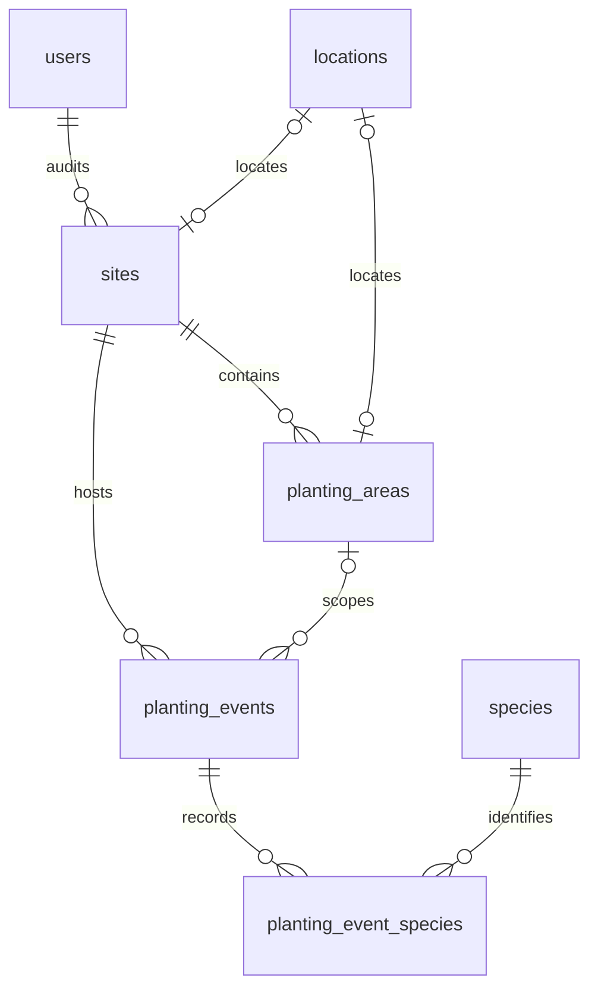

# Database

The schema is defined in [`../supabase/migrations/20261023000000_create_planting_records.sql`](../supabase/migrations/20261023000000_create_planting_records.sql). This single initial migration creates a **new** database with seven domain tables and 16-character text IDs for direct Supabase access. Saved records are the source of truth; there is no review status, confidence assessment or approval workflow.

The database layer talks to Supabase through `@supabase/ssr`, as the signed-in person. PostgreSQL grants and row-level security decide what they can read and change. The running pages still use `CsvWrtRepository`; this migration does not connect them to Supabase or import any data.

| Path | Holds |
|---|---|
| `types.ts` | Supabase JSON row/insert/update types for every migration table, view and public function. Independent of form types, so unknown historical dates are permitted. Replace with `supabase gen types` after provisioning. |
| `enums.ts` | Runtime database enum values used by form validation; keep in sync with the SQL migration. |
| `ids.ts` | Shared `domainId` Zod schema and `DomainId` type, plus `generateUniqueID` and the seven domain prefixes. |
| `queries/` | Every read. `views.ts` has one base query per view (its columns and order); `sites.ts`, `species.ts` and `plantings.ts` add a filter or a limit on top. |
| `usecases/` | Every write, one folder each. `types.ts` spells out what staff fill in and the zod check with its messages; `index.ts` saves it. |

## Schema



The seven target tables are `users`, `locations`, `sites`, `planting_areas`, `species`, `planting_events` and `planting_event_species`. Slugs are URL keys, separate from IDs. New IDs default to 16 URL-safe characters; supplied target IDs are also accepted. An area's site must match its event's site, enforced by a composite foreign key.

Supply a prefixed ID on insert using `ids.ts`:

```ts
import { generateUniqueID, IdPrefixes } from "@/db/ids";

const speciesId = generateUniqueID(IdPrefixes.SPECIES);
// Example: "spc_6n8k2j4m9q0r" (4 prefix characters + 12 random characters).
```

Each call creates a new random ID. Generate once when creating the record, pass it as the insert's `id`, and reuse the stored ID for edits and references. The helper uses Web Crypto and works in browsers and Node.js. Inserts that omit `id` still use the SQL default, which generates an unprefixed ID.

Use `domainId` from `@/db/ids` for every ID or foreign-key field in a use case's Zod schema, for example `species_id: domainId` or `planting_area_id: domainId.nullish()`. `DomainId` is its inferred TypeScript type. The schema checks the shared 16-character SQL rule, accepting both prefixed IDs and existing database-generated IDs. Use cases also parse standalone ID arguments before querying Supabase. URL slugs and the Supabase Auth UUID are separate formats.

Clients use Supabase table, view and function types directly; the former HTTP request/response contracts and Kysely types are not dependencies. The `planting_event_type` PostgreSQL enum retains the domain values from the former API: `establishment`, `infill`, `replacement`. It is exposed through `Database["public"]["Enums"]`, with runtime values in `enums.ts` for form validation. Other finite-value columns retain their existing CHECK constraints; the attached API contract supplies no additional column enums.

- `planting_events.season` is plain text, such as `summer` or `winter`, with no season table, foreign key or allowed-value list. New planting-day forms require a nonblank label. Historical imports can retain a label including its year when no exact date is known. Reporting groups exact labels alphabetically.
- `planting_events.planting_date` and `event_type` are nullable. Historical backfill uses `source = 'workbook'`; its exact day and type stay null. There is no fabricated first day of a season.
- The planting-day form and `save_planting_day` RPC still require a real date for new entries. Historical backfill inserts directly into the tables using trusted operator/service credentials and an explicit domain audit actor.
- Quantities may be null for unknown counts. Non-null quantities must be non-negative safe integers. Aggregates reject totals above JavaScript's safe integer range. An all-unknown group's known plant total is zero; its individual line quantities remain null.
- History lines retain `legacy_code`, `precision` and a `provenance` JSON object. Store the source file, sheet, cell and original season/site/species strings in that object. Saved species names and quantities are authoritative; corrections use normal edits and the audit trail. General planting notes belong on `planting_events.notes`.
- Locations store GeoJSON Points as `[longitude, latitude]`, plus an optional radius and source metadata. `area_list` falls back to the site's pin when the area has none.

## Reference seed

[`../supabase/seed.sql`](../supabase/seed.sql) is a one-time snapshot of the species profiles, photos and site locations in `data/`. Maintain this SQL file directly. It seeds 95 species, 29 sites, 50 locations and 50 planting areas (36 mapped parcels and 14 defaults), with `usr_000000000001` as the audit actor. Stable IDs and `ON CONFLICT DO NOTHING` preserve existing rows on reruns. The seed contains no planting events or quantities. See [the setup guide](../docs/supabase-setup.md#seed-the-reference-data) for loading details.

## Access and edit trail

An administrator creates domain `users` rows and links `auth_user_id` to Supabase Auth. Only an active row with `is_staff = true` permits edits. Signing in alone does not grant staff access. Clients cannot create accounts or change `is_staff`; use the SQL editor or trusted operator tooling.

Staff can read retired/unpublished table rows, insert and update domain data. Anonymous and non-staff readers can read only active published data. Events require a published site and, when present, a published area; lines also require a published active species. Account data remains staff-only (a signed-in person can read their own account). Published lines expose their provenance, as the explorer already does through its source expander.

All reporting views use `security_invoker = true`, so the caller's table RLS applies. Totals sum the saved quantities into a single `plants` value. See [Supabase's RLS guidance](https://supabase.com/docs/guides/database/postgres/row-level-security).

Triggers set the real domain audit actor from `auth.uid()`, preserve creation fields and IDs on update, stamp edit times and keep the first retirement timestamp. Operator imports without an Auth session must supply `created_by` and `updated_by`. No application role receives DELETE permission. The `save_planting_day` RPC runs with the caller's permissions and atomically saves an event with its lines.

## Apply and verify

Follow the [Supabase setup and migration guide](../docs/supabase-setup.md) for prerequisites, first local startup, applying and checking migrations, local environment variables, staff-account setup, generated types and hosted deployment. Keep setup commands in that guide so there is one maintained sequence to follow.

`npm test` checks CSV/domain behavior and form validation. Verify the migration, grants/RLS, triggers, views and RPCs against a local Supabase database before deployment; the unit suite does not exercise PostgreSQL or hosted Supabase behavior.

## Calling them

A page reads on the server. A form shows messages with the use case's schema in the browser, then writes through a server action that passes the raw input on.

```ts
const page = await getSpecies(await createClient(), slug);          // db/queries/species
const saved = await updateSpecies(await createClient(), slug, input); // db/usecases/edit-species
if (!saved) return { error: "Species not found." };
```

Every use case parses its own input and throws on anything its form would reject, so the check can't be skipped. Every write returns the changed row, or null when it is missing, retired or not yours to change; the page decides what to say.

## Words

| Word | Means | Was also called |
|---|---|---|
| site | A place people plant: Lake Hayes, Whitechapel | place |
| area | A part of a site as WRT registers it, with its site number. Screens say "part" | parcel, part |
| pin | A site's or an area's map marker, with an optional radius | location, site_location |
| season | A free-text label on an event, such as summer or winter | |
| event | One site, optionally one area, one season, and for new forms one day | planting day |
| line | How many of one species went in on one event | record |

## Rules

- Queries stack one call per line, like parameters, starting with `.from` under `db`. The linter enforces every line after the first; `npx eslint --fix db` fixes them.
- Totals count saved quantities directly; there is no resolved/review split.
- Nothing is deleted. Retiring sets `deactivated_at`, once: retiring again returns null and keeps the first date.
- Views hide retired rows. Tables don't, so staff can still see them; a query that reads a table filters `deactivated_at` itself, as `listSpecies` does.
- An unknown count is `null`, never 0.
- Supabase returns at most 1,000 rows a request, so unbounded reads page: `findLines` takes a page number.
- Saving a planting day calls `save_planting_day`, so an event and its lines land together.

## Next

1. Provision the project, apply the migration, bootstrap staff and adopt generated types.
2. Build a repeatable historical import using the service key. Preserve source values and provenance. The old Drizzle import at 3751999 contains useful mapping rules but uses the superseded numeric schema.
3. Implement sign-in and session refresh (`proxy.ts` in Next 16) before wiring authenticated pages.
4. Creating a pin and restoring retired rows need dedicated flows; today `place-pin` only moves/retires a location and the edit trigger preserves retirement.
5. Move pages to database queries and forms to use cases, or implement a database `WrtRepository` for the existing query layer. Reference profiles/photos and reconciliation still come from local files.
