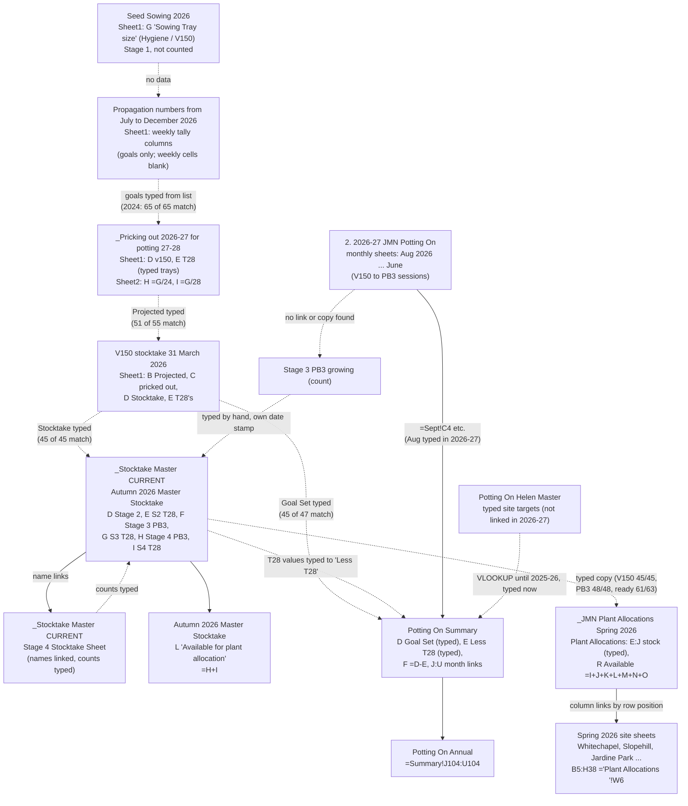

# 04b. Production pathways and containers: how the folder actually records them

Specialist S4b. Read-only analysis of the ScoutReports (B05, B06, B07, B08, B10, B12–B22), with source ranges re-opened only to check points. File paths below are shortened: `Stocktakes` means `4. Stocktakes`, `Propagation` means `2. Propagation (cuttings and seeds)`, `Allocation` means `5. Seasonal Planting Lists & Collection Schedule`.

## 1. The short version

1. **Containers.** Four codes carry nearly all the meaning: **V150** (24 plants per tray), **T28** (28 per tray), **PB3** and, in older files, **35F**. "Hygiene" is the germination tray in the 2024–2026 sowing lists. Everything else (`7`, `5`, `90`, `63F`, `RX90`, `1L`, `6 cell tray`) is a legacy pot code in seed and cutting records only. Full inventory: `04b_container_terms.csv`.
2. **Stage numbers appear in only one place.** The words "Stage 2 / Stage 3 / Stage 4" are used only in the 2026 stocktake master and the two allocation workbooks copied from it (`Stocktakes › _Stocktake Master CURRENT › Autumn 2026 Master Stocktake › D3:I3`; `Allocation › 2026 Spring planting › _JMN Plant Allocations Spring 2026 › Plant Allocations › E4:J4`). Every older file names the container instead (V150, PB3, T28) and leaves the stage to be worked out. Stage 1 is never counted anywhere (confidence: high; term scan of all .xlsx files).
3. **Readiness** is shown by column position, not by a status field. Stage 3 = growing, Stage 4 = ready in the 2026 master. In 2024–25 stocktakes it is "large" (ready) versus "small" (growing), split by north and south nursery. Before October 2023 the stocktakes did not record readiness at all (confidence: high; `Stocktake Spreadsheet October 2023 › Sheet1 › G` note, `20 May 2025 JMN Stocktake › Oct 24 › H8`).
4. **T28 species.** The data supports **four species as consistently T28** (toetoe, *Carex secta*, cabbage tree, and harakeke/flax *Phormium tenax*, the last since late 2024), **one more in practice** (*Poa cita*), a larger group that used T28 in some years, and several that disagree between sources. See section 3.
5. **The roll-up is mostly re-typing, not formulas.** Inside one workbook the arithmetic is formula-linked (monthly sheet → Summary → Annual; Stocktake master → "available"; allocation master → site sheets). **Between workbooks there is no link at all** (I checked the 56 workbooks in the Potting On, Stocktakes, Seasonal Planting Lists, pricking-out and seed-sowing folders: none has an external link). Numbers move between files by typing or pasting, and in several cases I could prove the copy: see section 4.
6. **The weekly pricking-out tally sheets hold no tallies.** Every file in `Propagation › _Pricking out lists` that looks like a weekly tally has goals filled in and the weekly and total cells blank (section 4, hop 1).

## 2. How containers and stages are recorded

### 2.1 The pathway as written down (confidence: high for the main route, medium for T28 details)

- **Stage 1** germination: `Seed Sowing 20xx › Sheet1 › G` ("Sowing Tray size": V150, Hygiene, `.5 V150`). Not counted as stock.
- **Stage 2** pricked out: V150 for most species; T28 for fast species. Planned in `Pricking out … › Sheet1 › C` ("Tray size", e.g. `14 T28`, `4 V150`) and counted in `V150 stocktake 31 March 2026 › Sheet1 › D:E` and `Autumn 2026 Master Stocktake › D:E`.
- **Stage 3** potted up into PB3 (growing): counted in `Autumn 2026 Master Stocktake › F` (+ `G` for T28).
- **Stage 4** ready: `Autumn 2026 Master Stocktake › H` (+ `I` for T28).
- **T28 shortcut.** The brief says fast species go germination → T28 → ready. The sheets mostly agree, but a stage 3 T28 column exists (`G`) and holds three species (Austroderia richardii 298, Cordyline australis 156, Plagianthus regius 140; `Autumn 2026 Master Stocktake › G7, G32, G78`). A 2025 note says `28 T28 to be potted imnto PB3` for *Melicytus ramiflorus* (`V150 stocktake 31.3.25 › Sheet1 › H44`). So T28 stock sometimes does move into PB3 (confidence: medium; two cells of evidence).

### 2.2 Container terms by family

| Family | Terms seen | Where | Note |
|---|---|---|---|
| Current trays | `V150`, `T28`, `PB3` | all current files | Spelling variants: `v150`, `T 28`, `2 T 28`, `8T28`, `7V150`, `12 V150, ` (stray comma) |
| Retired tray | `35F` | 22-23 and 23-24 pricking-out lists; seed records | Last used in the list for 2024/25. Folded into a combined `V150/35F` stocktake column 2018–2023 although the species using it are the T28 species (conflict; confidence: low on what 35F is) |
| Germination | `Hygiene`, `Hygene` (misspelt), `.5 V150`, `cuttings` | Seed sowing 2024–2026 col G | Container for Stage 1 only |
| Legacy codes | `7`, `5`, `90`, `5&7`, `5,7`, `63F`, `RX90`, `1L`, `6 cell tray` | Seed records MASTER col J; Cuttings records col H | 2016–2022 records. Sizes undefined. Floats such as `7.0` appear in 102 cuttings cells |
| Stage words | `Stage 2/3/4`, `Pricked OUT`, `Potted Up`, `Ready for planting` | 2026 stocktake master and allocations only | See 2.1 |
| Readiness words | `large`/`small`, `Larger`/`Smaller`, `Ready`/`Small` | 2022 (Larger/Smaller), Feb 2024 (Ready/Small), Oct 2024 onwards (large/small) | Three different vocabularies in three years |
| Place words | `North Nursery (Old)`, `South Nursery (New)`; later `south large`, `north large` etc. | stocktakes 2020–2026 | North/South was a column banner in 2020–2023; from Oct 2024 it is a column pair per readiness |
| Space units | `# of bays? 15 rows x 9 = 135 per bay` | Autumn 2026 Master Stocktake K3 | 135 is typed into the formulas |

### 2.3 How readiness and location are shown, by period

| Period | Stocktake file | Readiness shown by | Nursery site shown by | Evidence |
|---|---|---|---|---|
| 2018–2019 | `JMN Stocktake 21 October 2018`, `12 May 2019` | None (PB3 column; separate V150 and 35F columns) | None | `Stocktakes › Old Stocktakes › … › STOCKTAKE › B, G, H` |
| Oct 2019 | `JMN Stocktake 26 Oct 2019` | None; `V150/35F` merged; stray `1L Pot` column | None | `STOCKTAKE › B:D` |
| 2020 | `Stocktake Spreadsheet May 2020` | None | North (V150/35F, PB3) vs South (PB3) | `Sheet1 › C1:G1` banners |
| Oct 2022 | `Stocktake Spreadsheet October 2022` | None | North: V150/35F and T28; South: PB3 | `Sheet1 › C1:H2` |
| Oct 2023 | `Stocktake Spreadsheet October 2023` | `Small PB3` vs `PB3` (first split) | as 2022 | `Sheet1 › F2:G2` |
| Feb 2024 | `Rolling Stocktakes Feb 2024` | `Ready` vs `Small` labels in row 2 | none | `Sheet1 › C2:D2` |
| Oct 2024 – May 2025 | `JMN Stocktake 18 October 24`, `19 Feb 2025`, `20 May 2025` | `large` = ready, `small` = growing | south vs north columns | `Oct 24 › C:F`; note `H12` ("all south = T28. Large ready for autumn, small for spring") |
| Mar–May 2026 | `_Stocktake Master CURRENT` | Stage 3 (growing) vs Stage 4 (ready) with a date stamp over each column | none; one column set | `Autumn 2026 Master Stocktake › D4, F4, H4` |

Confidence: high for the column labels (read directly); medium for "large = ready" because only one note states it.

### 2.4 Mixed or misleading columns worth knowing about

- `V150/35F T28` is one combined column in the Oct 2024 – May 2025 stocktakes (`Oct 24 › B`). It holds both V150 and T28 counts; only some values are multiples of 28 (`=6*28`, `=16*28`), so the two cannot be separated reliably (confidence: high that they cannot).
- `V150 T28` in `JMN Plant Allocation Master SPRING 2025 › Spring 2025 › G` copies the same six species and the same numbers as the 20 May 2025 stocktake (168, 448, 476, 84, 168, 18): a re-keyed copy. Poa cita 18 is not a multiple of 28, so the column mixes containers.
- `%survival` in `Seed & Cutting results MASTER › Sheet1 › G` holds container codes (V150 50 rows, T28 10, 35F 7) mixed with fractions.
- In `Pricking Out List for 2025_2026 › Sheet1` column A and column B list different species from about row 28 onward (e.g. A28 `Coprosma rugosa`, B28 `Cordyline australis`). The T28 tray text and the red font sit against column B. If a parser reads column A, it will attribute T28 to the wrong species (Coprosma rugosa, Halocarpus bidwillii, Melicope simplex, Melicytus alpinus). I checked: those four are false positives.

## 3. Which species use T28, according to the data

### 3.1 Evidence matrix

Key: **PO** = pricking-out list tray-size text; **SW** = seed sowing list; **RF** = red font convention; **SK** = stocktake T28 column with a count; **PU** = Potting On "Less T28" / "T28 (exclude)"; **SR** = seed records "Pot size" value. Years are production years, or stocktake dates.

| Species | Evidence for T28 | Evidence against / disagreement | Verdict |
|---|---|---|---|
| *Austroderia richardii* (toetoe) | PO every year 2022/23–2026/27 (`14 T28` in 25/26); SW 2024, 2025; RF all; SK Oct 2022 (56), Oct 2023 (140), Mar 2025 (476), Mar 2026 (416), master Stage 2/3/4 (416/298/316); PU 2023/24–2026/27; SR 7 rows | None | Core T28 (high) |
| *Carex secta* | PO every year (`21 T28` in 25/26, but only `11 T28` in 24/25); SW; RF; SK Oct 2022 (308), Mar 2025 (420), Mar 2026 (392); PU 2024/25–2026/27; SR 5 rows | Oct 2023 stocktake shows *Carex virgata* (56), not secta, in the same row slot; PU 2023/24 lists *C. virgata* 56 and no secta | Core T28 (high). The *virgata* substitution in 2023 is a possible mis-naming (confidence: low) |
| *Cordyline australis* (tī kōuka) | PO every year (`13 T28`); SW; RF; SK Oct 2022 (280), Oct 2023 (120), Mar 2025 (476), Mar 2026 (392), master Stage 2/3/4 (392/156/308); PU 2023/24 and 2026/27 | Missing from "Less T28" in 2024/25 and 2025/26 although in T28 in the 2025 stocktake | Core T28 (high) |
| *Phormium tenax* (harakeke) | PO 22/23 (`9 V150, 21 T28`), 23/24 (`10 V150, 20 T28`), 25/26 (`24 T28`), 26/27 (T28 col `34`); SW 2025 (`24 T28`); SK Oct 2022 (140), Oct 2023 (364), Mar 2025 (448), Mar 2026 (644), master Stage 4 (224); PU all years | 24/25 list says `25 V150,` and the 2024 sowing list says `V150`; not red in the 2024/25 tally sheets. Note in `Pricking Out List for 2025_2026 › F62`: `changed to22 T28 (616)30/10/24` shows the change was deliberate | T28 since late 2024; mixed before (high) |
| *Phormium cookianum* (mountain flax) | PO 26/27 T28 column (5 trays on Sheet1, 6 on Sheet2); PU 2024/25 and 2025/26 (160) | PO 24/25 and 25/26 say `2 V150`; SW 2024/2025 say V150; absent from every stocktake T28 column | Disagrees (low). Possibly T28 only in 2026/27 |
| *Poa cita* | PO 25/26 (`6 T28`), 22/23 (`5 T28`); SW 2024 (`T28`), 2025 (`8T28`); RF 2024 and 2025 sowing; SK Mar 2025 (112), Mar 2026 (224), allocation Stage 4 T28 (224); SR 5 rows | PO 24/25 `3 V150`; PO 25/26 says 6 trays but SW 2025 says 8; absent from PU in every year; master puts 224 in Stage 2 T28 but the Spring 2026 allocation moves it to Stage 4 T28 | T28 in practice, container stage unclear (medium) |
| *Leptospermum scoparium* (mānuka) | PO 22/23 (`10 T28`), 23/24, 24/25, 25/26 (`6 T28`); SW 2024, 2025; RF 2024/25; SK Oct 2022 (280), Oct 2023 (224), Mar 2025 (84); PU 2023/24; SR 4 rows | Not T28 in Mar 2026 stocktake, and not in the 2026/27 T28 column | T28 2022–2025; no longer in 2026 (medium) |
| *Olearia avicenniifolia* | PO 22/23–25/26; SW 2024, 2025; RF; SK Oct 2023 (28); PU 2023/24 | Not in any 2025 or 2026 stocktake T28 column | T28 2022–2025 (medium) |
| *Olearia arborescens* | PO 22/23 (`1 T28`), 24/25 (`2 T 28`), SW 2024 `T28`; RF 2024/25 | PO and SW 2025/26 both say `4 V150` although the name is still in red font in the 25/26 list (`Pricking out 2025-2026 … › A32`) | Disagrees: T28 in 2024/25 only (medium) |
| *Plagianthus regius* (lowland ribbonwood) | PO 22/23 (`11 V150, 11 T28`), 23/24 (`11 V150, 9 T28`); SK Mar 2025 (140), Mar 2026 (140), master Stage 3 T28 (140); PU 2026/27 (139); SR 1 row | PO 24/25 and 25/26 say V150 only (`21 V150`, `15 V150`); not red in any 2024+ tally | Stocktakes say T28, plans say V150 (conflict; medium). 139 versus 140 in the 2026/27 deduction |
| *Poa colensoi* | SK Oct 2023 (84), Mar 2025 (65); PU 2023/24 (84); SR 1 row | 65 is not a multiple of 28; not in any PO list | Occasional T28 (low) |
| *Carex virgata* | PO 22/23, 23/24 (`3 T28`); SK Oct 2023 (56); PU 2023/24 (56); SR 2 rows | Not in later years | T28 2022–2023 only (medium) |
| *Carex buchananii*, *C. maorica* | PO 22/23 (`2 35F, 4 T28`; `3 T28`); SR 1 row each | Later lists leave Tray size blank | Weak (low) |
| *Melicytus ramiflorus* | Note `28 T28 to be potted into PB3` (Mar 2025 stocktake H44); SR 1 row | No other evidence | Weak (low) |

**Not T28 despite a first reading:** *Coprosma rugosa*, *Halocarpus bidwillii*, *Melicope simplex*, *Melicytus alpinus* (misaligned column A in the 2025/26 draft; see 2.4) and *Pittosporum eugenioides* (red in the 2025 sowing list but written `4 V150`).

### 3.2 Points where sources disagree

1. **The brief's "tussocks" are not T28 in the data.** No *Chionochloa* species has T28 anywhere. Only *Poa cita*, *Poa colensoi* and several *Carex* do.
2. **Red font is not a reliable T28 flag.** The footer `Red into T28 all others V150` exists only in the 2024/25 tally sheets (`Propagation numbers from July - Dec 2024 › Sheet1 › A86:A87`; `Propagation Jan - April 25 Final › Sheet1 › A86:A87`). Those six red species (toetoe, *C. secta*, cabbage tree, mānuka, *O. arborescens*, *O. avicenniifolia*) leave out harakeke and *Poa cita*, which the stocktake shows in T28. In the 22/23 list the red names (*Coprosma crassifolia*, *Metrosideros umbellata*, *Olearia fimbriata*, *O. lineata*, *O. odorata*) are all V150, so red there means something else.
3. **Planning and stock disagree.** The pricking-out list and seed sowing list say what was planned; the stocktake says what was counted. For harakeke, *Poa cita*, *Plagianthus* and *Phormium cookianum* the two disagree in at least one year (table above).
4. **The Potting On deduction is a hand-typed copy, and the species list shifts yearly.** 2023/24 deducts seven species (140, 56, 120, 224, 28, 364, 84 = 1016), identical to the Oct 2023 stocktake T28 column. 2024/25 and 2025/26 deduct four (170, 700, 160, 1040 = 2070), matching no stocktake. 2026/27 deducts five (416, 392, 392, 644, 139 = 1983) against the Mar 2026 stocktake's 416, 392, 392, 644, 224 (*Poa cita*), 140 (*Plagianthus*). *Poa cita* is not deducted in 2026/27 and *Plagianthus* is 1 short.
5. **Two sheets in one file disagree.** `_Pricking out 2026-27 for potting 27-28 .xlsx`: *Phormium cookianum* target is 140 (5 T28 trays) on Sheet1 and 168 (6 trays) on Sheet2 (`Sheet1 › C71:E71` vs `Sheet2 › G71:I71`).
6. **The stocktake T28 total does not match its parts in 2025.** `V150 stocktake 31.3.25 › Sheet1 › E90` shows 2212; the nine species rows sum to 2277. The difference is exactly 65, the *Poa colensoi* value (confidence: high; I summed the cells).

## 4. Where pricking-out and potting-up tallies live, and how they roll up

### 4.1 The chain, hop by hop

| Hop | From | To | Linked how | Evidence |
|---|---|---|---|---|
| 1 | Weekly propagation tally sheets (`Propagation › _Pricking out lists › Propagation numbers from July to December 2026`, `Propagation numbers from July - Dec 2024`, `Propagation Jan - April 25 Final`, plus blank templates) | nothing | **Nothing is entered.** Weekly and Total cells blank in all three; no formulas in any of them, so the weeks → month → Total roll-up is only a design on paper. Goals are typed | `… › Sheet1 › C3:AF87` blank (2026), `C4:S87` blank (Jan–Apr 2025), `C3:AA86` blank (Dec 2024); typed totals `B88`, `B85`, `B84` |
| 2 | Tally sheet goals | Pricking-out list targets | **Typed copy.** July–Dec 2024 goals equal the 2024/25 pricking-out list for 65 of 65 species compared. The July–Dec 2026 goals match neither the 2025/26 nor the 2026/27 list (0 of 38 compared; the goals are larger, e.g. 665 vs 392 for toetoe), so the basis is unknown (confidence: low) | `Propagation numbers from July - Dec 2024 › B3:B83` vs `Pricking out 2024-25 for potting 25-26 › B2:B92` |
| 3 | Pricking-out list (B05) | V150 stocktake "Projected" column | **Typed copy.** "Projected PU25/26" equals the pricking-out target for 51 of 55 species compared (2026), and 81 of 81 (2025) | `V150 stocktake 31 March 2026 › Sheet1 › B2:B84`; `V150 stocktake 31.3.25 › Sheet1 › B2:B84` |
| 4 | Actual pricked out | V150 stocktake col C ("pricked out") | **Typed.** This is the only place the number actually pricked out appears. Surplus (F) and deficit (G) columns are typed too, not B−C. No source for the typed values exists in the folder | `V150 stocktake 31 March 2026 › Sheet1 › C2:G84` (scout B17: F, G hard-coded) |
| 5 | V150 stocktake col D | Stocktake master Stage 2 (D) | **Typed copy.** Match 45 of 45 non-zero rows (31/03/26 stamp on both) | `Autumn 2026 Master Stocktake › D5:D108` vs `V150 stocktake 31 March 2026 › Sheet1 › D2:D84` |
| 6 | V150 stocktake col D (Stage 2 count) | Potting On "Goal Set" | **Typed copy.** 45 of 47 goal values equal the 31 March V150 count. That matches the brief ("Potting on list built from … the latest propagation stocktake") but nothing is linked | `Potting On 2026-27 › Summary › D4:D101` vs `V150 stocktake 31 March 2026 › Sheet1 › D2:D84` |
| 7 | Volunteer potting-up sessions | Potting On monthly sheets | One sheet per month; per-species row total is a formula (`=SUM(D:…)`) | `Aug 2026 … June › C4:C101` (2026/27); `B4:B101` (2022–24) |
| 8 | Monthly sheet totals | Summary monthly columns | **Formula** (`=Sept!C4`, etc.), same row position (rows matched by position, not by species name). Exception: 2026/27 **August is typed** (97 of 98 cells typed, J77 is the only link) | `Summary › K4:K103 =Sept!C#`; `J4:J103` |
| 9 | Summary totals | Annual sheet | **Formula** (`=Summary!J104:U104`), with running cumulative formulas. In 2026/27 the row labels are stale (`2020/2021`, `2023/24`, `2024/25`), so the live year sits under the wrong label | `Annual › B8:M8`; `A4:A8` |
| 10 | Helen Master (typed target by site) | Summary "Goal Set" | 2024/25 and 2025/26: **formula** (`=VLOOKUP($B4,'Helen Master'!$B$4:$J$93,9,false)`). 2026/27: **typed** (no formula in D4:D101). Helen Master in 2026/27 matches none of the goals (0 of 47) | `Summary › D4`; `Helen Master › I4:J92` (J = I×2) |
| 11 | "Less T28" | Summary col E | **Typed**; `F = D − E` is a formula. In 2025/26 F4 is typed 37 where other rows use the formula | `Summary › E6, E9, E31, E73, E77`; `F4:F101` |
| 12 | Potting On monthly totals (PB3 potted) | PB3 stocktake (B16) | **No link and no copy found.** Stage 3 (F) is typed with its own stamp | `Autumn 2026 Master Stocktake › F4:F108` (48 typed, 0 formulas) |
| 13 | Stocktake master Stage 2/3/4 | Allocation workbook stock columns | **Typed copy.** V150 45/45, PB3 growing 48/48, ready 61/63 match; T28 columns were edited by hand (e.g. `=416-308`, `=392-H33`) and Poa cita 224 moved from Stage 2 T28 to Stage 4 T28 | `Spring 2026 › Plant Allocations › E:J` (0 formulas in E, G, H, J; 2 in F, 1 in I) |
| 14 | Stocktake master Stage 4 | "Available for plant allocation" | **Formula inside the master:** `L = H + I` (PB3 ready + T28 ready). In the allocation workbook: `R = I+J+K+L+M+N+O` (adds school/QLDC/other-nursery stock and bought-in). Stage 2 and 3 are never in "available" | `Autumn 2026 Master Stocktake › L5:L108`; `Plant Allocations › R6:R107` |
| 15 | Allocation master | Per-site print sheets | **Formula**, one linked column per site, matched by row position (`='Plant Allocations '!W6`). Some sites now point at deleted sheets (`#REF!`: Little Difference, Peace Park, QEII, Paper for Trees in Autumn 2026) | `Allocation › Autumn 2026 › Slope Hill › B5:H38`; `Whitechapel › B5:H38` |
| 16 | Stage 4 stocktake sheet (volunteer count form) | Master | Species names link (`=…!B6`); counts and location text are typed | `Stage 4 Stocktake Sheet › A5:I39` |

### 4.2 Linked versus typed, summarised

- **Formula-linked (inside a workbook):** monthly session totals; monthly sheet → Summary → Annual in Potting On; `Total to be potted on = Goal − Less T28`; stocktake master `Available = Stage 4 PB3 + Stage 4 T28`; allocation "available", "allocated" and "over/under" columns; allocation master → site sheets; V150 → tray conversion (`/24`, `/28`) in the 2026/27 pricking-out Sheet2.
- **Typed or pasted (between workbooks, and many figures inside them):** the entire path pricking-out list → V150 stocktake → stocktake master → allocation; Potting On goals (2026/27); Less T28; all three T28 columns in stocktakes; the V150 pricked-out figures; every weekly tally goal; stock columns in allocation workbooks, often as typed arithmetic (`=48+18-15`, `=6*28`).
- **Never connected:** potting-up counts (PB3) do not feed the PB3 stocktake; pricking-out actuals do not exist as weekly data; planting actuals are in the plants-out master (outside this brief).

### 4.3 Conversion factors and where they are hard-coded

| Factor | Meaning | Where |
|---|---|---|
| 24 plants per V150 | Tray count × 24 | `_Pricking out 2026-27 … › Sheet2 › H3:H99 =G/24` (52 cells); lookup `M3:M42 =L*24`; Sheet1 `D` typed tray counts. Inferred only (also `Seed Sowing 2026 › C ≈ B/24`, confidence: medium) |
| 28 plants per T28 | Tray count × 28 | `Sheet2 › I5:I72 =G/28` (5 cells); lookup `N3:N42 =L*28`; stocktake arithmetic `=6*28`, `=16*28`, `=17*28` in `20 May 2025 JMN Stocktake › Oct 24 › B9:F81` (9 cells), `JMN Plant Allocation Master SPRING 2025 › Spring 2025 › G8:F75` (5 cells) |
| 135 plants per bay | Space needed ÷ 135 | `Autumn 2026 Master Stocktake › K5:K107 =J/135` (103 cells); `Spring 2026 › Plant Allocations › Q6:Q105 =P/135` (100 cells) |
| 11,000 ÷ 9 per month | Annual potting goal spread over nine months | `Potting On 2024-25/2025-26 › Summary › row 106 =11000/9` (scout B15) |
| 1.5, 3 | Multipliers on allocation site columns (e.g. `=V*1.5`, `=AB*3`), apparently contingency or per-1000 scaling | `Spring 2026 › Plant Allocations › W6:W107`, `AC6:AD107` (not tray conversions; flagged only) |

None is a named constant or a lookup cell; each is typed into the formulas, so changing a tray size means editing hundreds of cells (confidence: high).

## 5. Pathway diagram (as the data records it)

Solid arrows are formulas. Dashed arrows are re-typed or pasted values (verified by matching cell values). Dotted arrows mean "no data to carry".

## 6. Quality issues found in this analysis

| Issue | Evidence | Severity |
|---|---|---|
| Weekly tally sheets are blank, so there is no weekly pricking-out record in the folder | `Propagation numbers from July to December 2026 › Sheet1 › C3:AF87` and the 2024 and Jan–Apr 2025 equivalents | High |
| Footer date on the 2026 tally says 2023 | `… › Sheet1 › A89` (scout B06) | Medium |
| Potting On 2026/27 goal is typed and equals the March V150 stocktake count, not the Helen Master target | `Summary › D4:D101` | Medium |
| Potting On Annual rows carry old year labels, so 2026/27 values sit under `2024/25` | `Annual › A4:A8` | Medium |
| T28 species lists differ by source and year (section 3) | multiple | High |
| Pricking-out 2025/26 draft: column A and column B list different species from about row 28 | `Archive › Pricking Out List for 2025_2026 › Sheet1 › A28:B97` | Medium |
| Stocktake T28 total 2212 differs from its parts (2277) by 65 | `V150 stocktake 31.3.25 › Sheet1 › E90` | Low |
| Allocation workbooks reference sheets that no longer exist (`#REF!`) | `JMN Plant Allocation Master AUTUMN 2026 › Little Difference, Peace Park, QEII, Paper for Trees › B5:H38` (scout B19) | Medium |
| Plants-per-tray factors hard-coded in about 400 formula cells | section 4.3 | Medium |
| 35F is undefined and silently merged with V150 in stocktakes | `Stocktake Spreadsheet October 2022 › Sheet1 › D` | Medium |

## 7. Limits of this analysis

- Term counts in the CSV count xlsx sheets only (362 sheets, first 400 rows each; legacy .xls files and version copies counted separately or omitted). They show spread, not exact frequency.
- I did not read cell comments, so notes held only in comments may be missed.
- "Typed copy" means the values were identical in the cells I compared; it does not prove who copied them or when.
- I did not examine Plants Out Master (B23) because the stocktake-to-allocation chain ends at the allocation site sheets for this task.

## Questions for WRT

1. **T28 list.** Which species are in T28 this production year? Are harakeke (*Phormium tenax*), *Poa cita*, *Phormium cookianum* and *Plagianthus regius* now T28, and did mānuka and the two *Olearia* stop using T28 after 2025?
2. **Red font.** Does red on a species name mean "goes into T28"? Why are red names in the 2022/23 list all V150 species?
3. **35F.** What was a 35F tray, how many plants did it hold, and when did you stop using it? Was it counted as V150 in the old combined stocktake column?
4. **Weekly pricking-out tallies.** Where are the filled-in weekly pricking-out numbers kept now (paper forms, another file)? The folder's tally sheets contain goals only.
5. **Stage 3 T28.** Does T28 stock get potted into PB3 for some species (Austroderia, Cordyline, *Plagianthus*), or does "Stage 3 T28" mean something else?
6. **Large and small PB3.** Is "large" always "ready", and is "small" the stage 3 growing stock? Does north versus south nursery matter for planning?
7. **Potting On goal.** Is the 2026/27 "Goal Set" meant to be the 31 March V150 count, or should it come from the target list (Helen Master)?
8. **Allocation "available".** Should "available" include stock from other nurseries and bought-in plants, and what do SPS and QPS stand for?
9. **Tray sizes.** Are 24 per V150 and 28 per T28 always correct, and what size is a PB3?
10. **Poa cita.** In the March 2026 stocktake, 224 *Poa cita* are in Stage 2 T28, but the spring allocation moves them to Stage 4 T28. Which is right?
