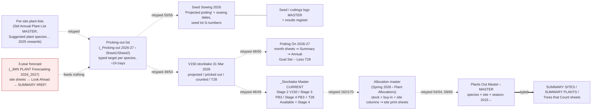

# WRT nursery records — the data shape today

*Discovery run on the `_ALL Plant Lists` Drive export (zip stamped 3 Oct 2026). Read-only. Every figure below is backed by a `file › sheet › range` reference in the numbered reports in this folder (`02_scouts/`, `04a`–`04g`, `05_*`, `06_verification.md`). Where a file name carries a person's name it is written `[name]`. No seed-source locations, coordinates or personal details appear in this document.*

**In one paragraph.** WRT's nursery data is one well-understood *process* (forecast → sow → prick out → pot on → stocktake → allocate → plant) carried by about 112 workbooks that are **not connected to each other**. Inside a workbook there are formulas; between workbooks every number is retyped. The species list is a 98-row alphabetical block copied into every current file, with the same misspellings carried along. Stock is counted as a snapshot a few times a year and never posted to; losses have no field. Planting history is one species × site × season grid going back to 2015; there are no planting-area codes, event dates, event types or volunteer counts anywhere. The ten live records in WRT's own "Summary of Records" are Google Sheets; this folder is their export plus fifteen years of archive copies.

---

## 1. What's in the folder

| | Count |
|---|---|
| Files | **190** (29.8 MB) — 103 `.xlsx`, 8 `.xls`, 1 `.csv`, 13 `.docx`, 2 `.doc`, 62 `.pdf`, 1 `.gpx` |
| Workbooks / sheets | 112 workbooks, 381 sheets (359 profiled; the rest are declared duplicates) |
| Exact duplicates | 7 groups, 16 files (e.g. `Seed Sowing 2026 To be updated.xlsx` is byte-identical to the 2025 list) |
| Version families | 52 "copied version" edges in `05_lineage_edges.csv`: results register ×8 copies, seed records ×8, cuttings records ×6, potting-on ×5 years, stocktakes ×24 dates, allocation masters ×4 seasons |
| Years covered | Planting history Autumn 2015 → Autumn 2026; seed/cutting logs 2016 → mid-2026; stocktakes Jun 2018 → Aug 2026; potting-on Aug 2022 → Sept 2026; forecasts to Spring 2028/Autumn 2030 (mostly empty) |

**Workbooks by workflow stage** (from `03_sheet_catalogue.csv`, one workbook may serve one stage): seed/provenance 30 · stocktake 22 · pricking-out 16 · allocation 14 · forecast 13 · potting-up 5 · production plan (site plant lists) 5 · TTC/orders 4 · species list 2 · planting history 2 · admin/site-map 3.
**Sheets by role:** data 213 · blank forms/templates 65 · summaries 32 · empty 25 · notes 16 · lookups 7 · chart 1.

**Which files are the live records.** WRT's `_Summary of Records JM Nursery.docx` lists ten records (three highlighted as the core: Seed Sowing List, Pricking-out list, Potting-on list). Kyle's copy of that list links each one to a Google Sheet. The folder export of each is, with confidence:

| WRT record | Folder export |
|---|---|
| 1 Forecasting sheet, 3 years ahead (new) | `1. Forecasting/_JMN PLANT Forecasting 2026_2027.xlsx` |
| 2 Seed collecting record | `…/Seed Collecting/4. Seed collecting record 2026 updated May 15 26 AA.xlsx` |
| 3 Seed records (living) | `…/_Seed and Cutting Records/2. Seed records MASTER.xlsx` |
| 4 Cutting records (living) | `…/1. Cuttings records MASTER.xlsx` |
| 5 Seed & cutting results (living) | `…/3. Seed & Cutting results MASTER.xlsx` |
| 6 Seed sowing list ★ | `…/Seed Sowing /Seed Sowing 2026 .xlsx` |
| 7 Pricking-out list ★ | `…/_Pricking out lists/_Pricking out 2026-27 for potting 27-28 .xlsx` |
| 8 Potting-on list ★ | `3. Potting On/2. 2026-27 JMN Potting On - August 2026 - July 27.xlsx` |
| 9 Nursery stocktake | `4. Stocktakes/_Stocktake Master CURRENT.xlsx` (+ V150 stocktake each March) |
| 10 Plant allocation list | `5. …/2026 Spring planting/_JMN Plant Allocations Spring 2026.xlsx` |
| 11 Plant allocation MASTER (history) | `_MASTER Nursery records and templates/_JMN Plants Out Master.xlsx` |

Two warnings: the Google links for records 9 and 10 share the same tab id, so they may be one workbook; and the "archive" copies are not always older — `Archive Seed Records/_Seed records-[name].xlsx` (927 rows, to Dec 2025) is newer than the `_MASTER` folder copy (848 rows). Nobody opened the Google Sheets in this run; everything here is from the export.

---

## 2. The workflow as the data shows it

Solid = formula; dashed = retyped (figures are "equal / compared species" from `scripts/lineage_check.py`); double = hand-typed summary. The full 122-edge graph is `05_lineage.mmd` / `05_lineage_edges.csv`.

**Read it as a yearly loop.** The pricking-out list for year *N* (set in January, rounded up to whole V150 trays of 24 or T28 trays of 28) is copied into the sowing list, then compared against the March V150 count. That count — not the target — becomes the potting-on *Goal Set* for year *N+1* (47 of 50 species equal). Potted plants are counted again as Stage 3/4 PB3; the ready figure is copied into the spring and autumn allocation masters, which add planned buy-in, council and school stock and split by site. The allocation totals are then typed into Plants Out Master as "planted" (98/98 species identical for Spring 2025), and from there typed again into the summary and Trees That Count sheets. Pricking-out for 2024/25 → potting 2025/26 → planting Spring 2026: the "two seasons later" rule holds (`04c` §8, Coprosma propinqua trace).

What the loop does **not** contain: any weekly pricking-out actuals (the tally sheets hold goals only, every week cell blank), any link from potting-on to the PB3 stocktake (0 of 52 species related), any loss field, and any post-planting count.

---

## 3. The current data shape — entities as they exist today

| Entity | Grain today | Where it lives | Key fields | Reliability |
|---|---|---|---|---|
| **Species** | one row in a 98-row alphabetical block, running number 1–98 | copied into every current file: `Standard Annual Plant List … MASTER › B4:B101`, `Plants Out Master › Master Plant List`, pricking-out, potting-on Summary, forecast, stocktake master, allocation masters | scientific name (free text), common/Māori name (patchy), `>5m` TTC flag (49/50/39 species depending on file), threatened `T` flag | **Medium.** Names match exactly across the current trio but carry shared misspellings; the running number is a row counter, not an ID. 664 raw species strings fold to ~160 groups (`04a`). |
| **Seed lot / cutting batch** | one row per tag (S-number / C-number) in the two living logs; one row per tray in the results register | `2. Seed records MASTER` (953 rows, two stacked tables), `1. Cuttings records MASTER` (536 rows), `3. Seed & Cutting results MASTER` (1,500+ rows, species headings interleaved with tray rows) | tag, species, **source site (sensitive)**, collected date, stratification, amount (mixed units), sown date, pricked date, count, container, notes | **Low–medium.** Tags restart at S1/C1 in 2022 (≈317 numbers exist twice); tag + sown date joins 84–93% of register rows; continuation rows, merged cells, text in date and count columns. |
| **Production target** | one species per production year | pricking-out list (`Sheet1 › C`; `Sheet2` adds a bulk-order split and "Spares 2500") | target (typed, tray-rounded), tray count, container text ("4 V150", "14 T28") | **Medium.** Totals stable ~10.7–11.1k/yr; `?` placeholders; TOTAL row mid-table; container embedded in text. |
| **Stock count** | one species × container × stage on one date; a new date is a new file (or an overwritten column) | 24 stocktake events 2018–2026 (`04e` §2.1); current: `_Stocktake Master CURRENT › Autumn 2026 Master Stocktake` (Stage 2 V150, Stage 2 T28, Stage 3 PB3/T28, Stage 4 PB3/T28); V150 count every March | date (in header text, often not the file name), container, stage/readiness, north/south nursery (2020–25), count (sometimes typed arithmetic `=41-10`) | **Medium for the count, low for history.** Snapshot only; four different column layouts over time; V150 column already includes T28 in the March count but not in the master (double-count trap); the Feb 2026 "stock" (9,551) vs "ready" (5,390) vs May master (5,706) do not reconcile. |
| **Potting-up event** | one species × dated session (week) | Potting On month sheets `D:H`; `Summary` sums by month; `Annual` by year | session date (header text, 44/50 real dates day/month-swapped), count, Goal Set, Less T28, To go | **Medium.** Formula-linked inside the book; Summary cells over-typed (73 of 100 in 2025-26); Annual rows mislabelled; month sheets still dated 2023. |
| **Site** | one column per site per season in MASTER; one row in `SUMMARY SITES` register | `Plants Out Master › MASTER` row 4 (name), row 5 (ID), row 6 (landowner org); `SUMMARY SITES › B:D, BD` (ID, name, landowner, K/C/S class) | site ID `15`, `9G`, `13C` (number + parcel letter), name (116 spellings → 77 groups), class Keystone/Community/School, landowner org (QLDC, DOC, Crown…) | **Medium.** IDs are the best key but: old numbering in 2015, two sites swapped 2024–25, `!!A`, no IDs at all for Autumn 2026, 14 newer sites never given one. |
| **Planting area** | **does not exist as data.** | First area-level columns appear in Autumn 2026 only (three Whitechapel blocks, Lake Hayes Pavilion infill); the "Location" column on 59 of 60 site print sheets is empty; no `WH-06`-style code anywhere | — | n/a |
| **Planting event** | **per site per season only** (Autumn/Spring + year) | `MASTER` season blocks; collection/planting date pairs only on 2025–26 allocation tabs (free text, template defaults) | count per species; no date, no type (only "infill" inside two labels), no volunteer count | **Low for event detail, medium for counts.** "Planted" = allocation retyped. |
| **Allocation** | one species × site column per season master; site print sheets linked by row position | `JMN Plant Allocation Master AUTUMN 2026 › Autumn 2026`, `_JMN Plant Allocations Spring 2026 › Plant Allocations`, `… SPRING 2025 › Spring 2025` | stock cols (typed from stocktake), From QLDC / QT Nursery / Buy IN / school stock, Total Available, Total Allocated, Over/Under, per-site columns (some `=per1000×1.5`) | **Low–medium.** Four to six competing "total allocated" figures per season; `#REF!` site sheets; tabs titled for other sites/seasons; SUM ranges stop short of appended species. |
| **Loss** | **no field.** | V150 surplus/deficit (= pricked-out − target, not deaths); free-text notes ("96 gone!", "damp off"); "discarded"/"dead" typed into count columns; one cell comment "10 plant deaths"; narrative in annual reports | — | n/a. A rough V150-vs-potting balance leaves ~3–4k plants/yr unexplained (low confidence). |
| **Bought-in stock** | column headings and order forms, never a supplier × date × quantity row | Spring 2024 order sheet (mostly empty), 2023 Home Creek invoice PDF, 2025 Springburn quote PDF, supplier columns in allocation masters, `Sheet18` "QT Nursery" plan (2,400) | supplier (org), season, quantity (plan or actual — not stated) | **Low.** Three different Home Creek totals for one season. |
| **Forecast** | species × site × season blocks, 7–8 seasons ahead | `_JMN PLANT Forecasting 2026_2027` (16 sheets): 10 typed site sheets → `3 Year Plant Look Ahead` (formula, row-position links) → `KEYSTONE SITES` / `SUMMARY` | typed site needs; GOAL row; group/school columns | **Low.** 2026/27 roll-up essentially empty; SUMMARY all `#REF!` (missing SCHOOLS sheet); row-offset misalignment (Feehly Hill 24 rows); feeds nothing downstream. Best working copy is `Archive to sort through/Aug 2025 Keystone Sites Plants Summary.xlsx`. |
| **TTC / funder extract** | species × season (2024–25), species (2020), species × site (2019) | `Plants Out Master › Trees that Count*` sheets, `SUMMARY PLANTS` D119:F125 | count, `>5m` flag, "16,000 funded / to go" | **Low.** Pasted values (177/230 match MASTER); typed constants (9,530; 2,503; 8,306…). |

---

## 4. Lineage and re-keying hotspots

Embedded graph: see §2 (full version `05_lineage.mmd`). Edge mix: 28 formula, **35 retyped**, 7 hand-typed summaries, 52 version copies. None of the 56 workbooks in the nursery folders has an external link; the only cross-workbook formulas are broken ones in the results register (to a `2a Seed records.xls` on OneDrive) and the forecast (to a non-existent `SCHOOLS` sheet).

Top five places people copy numbers by hand (ranked by figures × frequency):

1. **Plants Out Master `MASTER` → `SUMMARY PLANTS`, `SUMMARY SITES`, three `Trees that Count` sheets.** ≈1,900 typed cells; a new typed column every season; TTC 2024-25 matches MASTER in only 177 of 230 cells. (`SUMMARY SITES` 428 typed vs 63 linked.)
2. **Allocation master → Plants Out Master season block.** ≈320 species × site cells each season, typed after the allocation (98/98 Spring 2025, 96/98 Autumn 2026). "Planted" is therefore the plan.
3. **Stocktake → allocation stock columns.** ≈300 figures twice a year (162/170 Spring 2026; 65/67 Spring 2025); T28 columns hand-edited; mixes stocktake dates and definitions.
4. **The yearly target chain.** Standard Annual Plant List → pricking-out (58/58, 98/98) → seed sowing (55/55) → V150 "Projected" (49/53) → tally-sheet goals (50/50 in 2024; 0/54 in 2026). ≈270 figures over five hops every year.
5. **March V150 count → Stocktake Master Stage 2 (48/49 with T28) and → Potting On Goal Set (48/50).** ≈145 figures; T28 species switch columns between the two.

Also notable: the species list itself (98 names) is retyped into every sheet of every workbook — the Spring 2026 master alone carries it 22 times — which is how the shared misspellings propagate and how row-position links break when a row is inserted (Feehly Hill forecast, `#REF!` at slot A20 in every Spring 2025 site sheet).

---

## 5. Species list reality

- **Distinct strings in species columns:** 1,799 raw (1,070 are tray codes, headings or notes); **664 species-level strings → 368 spellings → ~160 proposed groups**, of which 133 occur outside the seed logs and 27 only in seed logs (species collected or sown but never planned, counted or allocated).
- **Likely real species in the nursery range: 97**, with 91–101 depending on which appended extras count (`04a` §4 table).
- **Why 93 ≠ 97 (arithmetic exact; reading is low-confidence):**
  - *97* = the 98-row core block (`Standard Annual Plant List … MASTER › B4:B101`, identical in Plants Out `Master Plant List`, pricking-out 2026-27, forecast KEYSTONE SITES) minus the one species entered twice under old and new genus (`Leonohebe cupressoides` B47 / `Veronica cupressoides` B95).
  - *93* = `Nursery plant names list.docx` (2026): 97 rows − 2 exact repeats (Astelia fragrans, Coprosma wallii) − `Cyathoides juniperina` as the old name of `Leptecophylla juniperina` − `Rata (KPCA)` (a site tag) = **93**; merging the cupressoides pair too gives 92.
  - The two lists share 88 species. Nine core species are missing from the docx (Carex buchananii, C. maorica, C. virgata, Carmichaelia crassicaulis, Coprosma acerosa, C. brunnea, C. cheesemanii, Discaria toumatou, Dracophyllum rosmarinifolium); four are in the docx but not the core (Astelia fragrans, Carex comans, C. flagellifera, Coprosma wallii). Current allocation and stocktake masters append 4–16 extra rows below the block (Autumn 2026 has 114 rows).
- **Every current list carries the same misspellings** as its most-typed form: *Weinmania*, *Scheflera*, *Parsonia*, *Leonohebe cuppressoides*, *Rakaua*, *Prumnopitys taxifolius*, *Coprosma brunea*; plus trailing spaces, a non-breaking space in `Plagianthus regius`, stray brackets on the two *Ozothamnus* rows. No macrons anywhere.
- **Contested pairs for WRT to rule on** (not decided here): Cyathoides/Leptecophylla juniperina; Carex maorica vs C. secta ("oio"); Coprosma dumosa/tayloriae; which Kunzea is "kānuka"; the three *Ozothamnus*; Rata (KPCA) vs Metrosideros umbellata. Review list: 208 strings in `04a_species_variants.csv` flagged `uncertain = Y`.

---

## 6. Location precision by year

| Years | Precision of planting records | Notes |
|---|---|---|
| 2015–2016 | site, with many registered sub-sites (letter-suffixed IDs) | 2015 uses the old ID numbering |
| 2017–2019 | site; few sub-sites; several sites with no ID | 2019 also has a species × site TTC extract |
| 2020–2023 | site and sub-site (IDs mostly present) | Autumn 2020 only 6 sites |
| 2024 | site plus named parts of Slope Hill (HGF 22,000; Coronation 7,000) and Jardine Park (Welcome Forest vs Reference Gardens) | these two Slope Hill columns are 21% of all-time plants; MASTER subtracts them in one total |
| 2025 | site; IDs mis-assigned for two sites and missing for nine columns | MASTER and SUMMARY SITES disagree on the year total (10,698 vs 10,717) |
| 2026 (Autumn) | **first area-level columns** (3 Whitechapel areas; LH Pavilion infill); **no IDs at all** | Spring 2026 not yet in MASTER |
| All years | no event date, no event type, no volunteer count, no coordinates, no photos | `04d` §4, `04g` §2.4 |

Only dated planting information anywhere: collection/planting date pairs on 2025–26 allocation tabs and collection schedules (site level, mixed real/text dates, template defaults of 1–2 May 2026 repeated).

---

## 7. Quality issues, ranked

1. **No links between workbooks; ~35 retyped hops, ~1,900 typed summary cells** (§4). Every figure can drift; several already have (totals 140,049 / 139,948 / 135,413 for all-time plants; 4–6 "total allocated" figures per season).
2. **Species names are free text with shared misspellings and no stable key** (§5); row-position links break on insertion (forecast misalignment up to 24 rows; `#REF!` in every Spring 2025 site sheet at slot A20; Autumn 2026 species 104–119 unlinked to any site sheet).
3. **Dates:** at least nine formats; day/month swapped where Excel "helped" (44 of 50 potting-on session headers; 15 of 24 real dates in the 2026 seed-collecting record; the 2016-17 seed file); bare serials in one archive seed log; impossible years (1900, 1905, 2003, 2010, 2012, 2027, 2424); month sheets still labelled 2023; file names that contradict content (`Autumn 2027` file holding 2026 data; `Seed Sowing 2026 To be updated` = 2025 data). (`04f`)
4. **Seed and cutting tags are not unique** (restart at S1/C1 in 2022; three tag styles; `S322`/`S324` reused in 2026) and the results register has no row ID; join works only on tag + sown date (84–93%). (`04f` §7)
5. **Stocktakes:** four column layouts over eight years; snapshot overwritten in place ("Updated 12/08"); V150-includes-T28 double-count trap; typed totals that disagree with column sums; dates in header text not file names; nine-month gap May 2025–Feb 2026. (`04e`)
6. **Allocation masters:** `#REF!` site sheets (Feehly Hill, Peace Park, QEII in 2025; Little Difference, Peace Park, QEII, Paper for Trees in Autumn 2026); tabs titled for other sites/seasons; stock typed as arithmetic (`=48+18-15`); "available" includes plants WRT does not hold (4,717 of 10,589 in Spring 2026); SUM ranges stop at row 103–105 while species run to 107–119.
7. **Forecast workbook is not live:** SUMMARY all `#REF!`; roll-up empty; look-aheads stop at Spring 2026; no 10–15% contingency parameter exists anywhere (the only multipliers are ×1.5, ×2, ×3 and tray rounding). (`04c`)
8. **Losses, deaths and discards have no field** — notes, arithmetic in cells and "discarded" text only. (`04e` §5)
9. **Site IDs faulty** (§6) and site names in 116 spellings; landowner row blank since Spring 2024.
10. **Seed logs:** two tables stacked with a second header mid-sheet; continuation rows with blank tag/species; merged cells (94 ranges); mixed units in Amount; container codes mixed with legacy pot numbers; red font on ~575 cells with no legend. (B08, B10)
11. **Weekly pricking-out tallies are never filled in** (goals only, in all three tally workbooks). (B06)
12. **TTC flag disagrees** between files (49 / 50 / 39 species over 5 m). (`04g` §2.3)

---

## 8. Sensitive data register (location and type only)

Full register: `04g_sensitivity_register.csv` (174 rows, 84 files). Summary:

| Type | Rows / files | Where |
|---|---|---|
| Seed and cutting **source locations** | 36 / 32 | `Site` column C in seed records and cuttings records (masters and all 14 archive copies incl. 2016-17 and the 2017 `.doc` tables); `Source` column B in the results register (8 copies); `Seeds Sown … and source` column D in the 2024–26 sowing lists; `Site` in the 2026 seed-collecting record and `Seed record 2026`; notes columns that may repeat places; a scanned QLDC seed-collection approval letter |
| Coordinates | 1 / 1 | `Remnant_kowhai_2019.gpx` — 94 waypoints, decimal degrees, no names; prefixes resemble the seed-log site codes |
| Personal names | 89 / 50 | volunteer/staff names in comments columns, `With who` in the 2026 collecting record, "last updated" cells and footers, person-named column headers (bulk-order columns in two pricking-out lists; a plant list column), sheet and file names (three seed-record files carry a staff member's full name), document properties (88 of 116 Office files carry an author) |
| Contact details | 16 / 15 | `WHO` columns in `SUMMARY SITES` / `HISTORIC SUMMARY SITES`; Paper4Trees 2019 order file (school staff names, phones, addresses); two email addresses in cell comments; supplier contacts on invoice/quote PDFs; one bank account number on an invoice |
| Comment authors | 15 / 12 | cell comments in stocktakes, potting-on, allocation masters |

Tag numbers alone are harmless, but tag + Site column gives the location, so an import should read tag and species from the logs and leave the Site/Source column behind until WRT decides who may see it. The leak scan of this `discovery/` folder (`04g` §4, re-checked independently in `06_verification.md`) found no coordinates, emails or phone numbers; one place name quoted in a scout file has been scrubbed; redaction term lists were moved out of the shared `scripts/` folder.

---

## 9. Migration candidates

| Dataset | Recommendation | Why |
|---|---|---|
| Species master (98-row block + variant map from `04a_species_variants.csv`) | **Import** (first) | Everything keys off it; needs WRT to rule on the contested pairs and accept a stable ID |
| Site register (`SUMMARY SITES` B:D + BD; IDs from `MASTER` row 5) | **Import** | Only durable site key; fix the known ID faults and add the 14 ID-less sites on the way in |
| Planting history (`Plants Out Master › MASTER`, 2015–Autumn 2026) | **Import** as species × site × season counts | The TTC baseline; keep "planted = allocation" caveat as a flag; do not import the SUMMARY/TTC sheets (derived, typed) |
| Current stock (`_Stocktake Master CURRENT` + V150 31 Mar 2026) | **Import** as one dated snapshot per column date | Seeds the MVP stock; note T28 handling |
| Pricking-out list 2026-27 and Seed Sowing 2026 "Projected potting" | **Import** as the 2026/27 production target | The core planning record; `?` rows need values |
| Potting On 2026-27 month sheets | **Import** sessions (species × date × count) | Only real event-level production data in the folder; fix swapped header dates on import |
| Allocation masters Spring 2026 / Autumn 2026 | **Import later** (site totals only) | Grain is right but totals conflict and site sheets are broken; take per-species-per-site allocated figures once WRT names the authoritative total |
| Seed/cutting logs and results register (2016–2026) | **Import later**, tag+date keyed, **without** the Site/Source column until access is decided | Valuable provenance; needs the tag-era rule and a sensitive-data decision |
| 2026 seed-collecting record, seed collection windows | **Import later** | Small; sensitive; dates need day/month confirmation |
| Historic stocktakes 2018–2025 (xlsx and PDF) | **Archive** (keep PDFs/xlsx; optionally load season totals) | Four layouts; low value beyond trend lines |
| Potting On 2022-23 → 2025-26 | **Archive**, load yearly totals only | Over-typed summaries; month data of past years rarely needed |
| Forecast workbooks (2026_2027, Keystone summaries) | **Archive** | Broken and empty; the forecast should be rebuilt from targets + planting needs in the new system |
| Per-site plant lists (Standard Annual Plant List, Suggested…, Master plant list 2024, Flagship 2023) | **Import later** as "site planting recipe per 1,000" after WRT picks one | Four disagreeing versions |
| Allocation PDFs 2022–2024, propagation reports, orders, Paper4Trees forms | **Archive** | Printed snapshots; species lists for 2022–24 site visits survive only here |
| Exact duplicates and `Copy of…` files (16) | **Archive / delete** | Byte-identical |
| GPX remnant kōwhai layer | **Hold** pending permission | Seed-source layer, not planting sites |

---

## 10. Questions for Anna and Sarah

1. Which species list is official, and what do "93" and "97" count? Are `Leonohebe`/`Veronica cupressoides` and `Cyathoides`/`Leptecophylla juniperina` one line each; are Carex maorica and C. secta separate; which Kunzea is kānuka; what is `Rata (KPCA)`?
2. Is the 10–15% contingency applied anywhere in a calculation, or is it a rule of thumb when choosing the tray-rounded pricking number? And what do the ×1.5 ("add 50% for 1,500") and "Spares 2500" rules mean — site-size scaling, demand or safety margin?
3. Which site-need list is current — the Standard Annual Plant List (6,500 model), the Flagship 2023 plan, or the forecast site sheets — and is `_JMN PLANT Forecasting 2026_2027` meant to be live given its SUMMARY is `#REF!` and the SCHOOLS sheet is missing?
4. Where are the filled-in weekly pricking-out numbers kept (paper, another file)? The folder's tally sheets hold goals only.
5. Is the potting-on Goal Set now defined as the 31 March V150 count (as in 2026/27), and has the "Annual Projection (best case)" sheet been retired?
6. Which species are T28 this year? The data supports toetoe, Carex secta, tī kōuka, harakeke and Poa cita; it disagrees on Phormium cookianum, Plagianthus regius, mānuka and two Olearia. No Chionochloa tussock is T28 anywhere. What does red font mean?
7. For each stocktake, which date is the count date (file name, header stamp, or save date), does the V150 column always include T28, and was there a whole-nursery count between May 2025 and Feb 2026?
8. Where should deaths and discards be recorded, with a reason? Notes such as "96 gone!" exist; no count was adjusted. Is a loss rate between pricking out, potting on and ready known?
9. Which "total allocated" is right for Autumn 2026 (4,562 / 4,593 / 4,601 / 3,234 / 5,629) and Spring 2025 (6,248 vs 6,229)? Should "available" include plants not yet bought or supplied by QLDC and schools?
10. Is Plants Out Master updated from what was actually planted, or from the allocation sheet? Were the Spring 2024 Slope Hill HGF (22,000) and Autumn 2024 Coronation (7,000) figures real plantings, and what do HGF and Coronation stand for?
11. Do planting event dates, event types (establishment / infill / replacement / enrichment), planting areas (e.g. WH-06), photos or coordinates exist anywhere outside these spreadsheets (TTC portal, QLDC GIS, paper)? None is in the folder.
12. Site IDs: are the bracketed codes (15, 9G, 13C…) the MASTER row-5 IDs; which of the swapped/odd IDs (Slope Hill 13C vs 11; Akarua 9E/9F; Derby St 13A/13D; `!!A`) are right; and should the 14 ID-less sites and the Autumn 2026 columns get IDs?
13. Seed and cutting tags: are the date-coded tags year+month+sequence, why did numbering restart at S1/C1 in 2022, and is a tag meant to be unique within a year or only within a sheet?
14. Seed-source locations and the 2019 kōwhai GPX: who may see them (volunteers, funders, council, public), and do the QLDC approval or landowner agreements restrict storage? May volunteer/staff first names be kept, or should the build use roles?
15. What has actually been submitted to Trees That Count (the "16,000 funded" block, the 2025 audit), which fields does TTC require, and which `>5m` list is correct (49, 50 or 39 species)?

---

## 11. Gaps

- The live Google Sheets were not opened; all findings are from the Drive export. Where an "archive" copy is newer than the "master" (seed records), the Sheet may differ from both.
- 62 PDFs were listed, not read (printed allocation sheets 2022–25, old stocktakes 2020–22, Paper4Trees orders, approval letter, invoice, quote). Three stocktake PDFs were read for headers and totals by one specialist; the April 2026 PB3 printout has no text layer.
- Cell comments and document properties were counted, not read; two site-plan images were not OCR'd.
- Cross-workbook links to `2a Seed records.xls` (OneDrive) and the forecast's `SCHOOLS` sheet point at files/sheets not in the folder.
- 56 sheets had no species column identified by a scout and are outside the species census.
- Verification (`06_verification.md`, seed 20261003): 6 of 10 sampled claims passed, 4 were partly wrong (count differences of one; one bullet mis-attributed; corrected in place), none failed. Species census per-list counts and the stocktake table were adjusted accordingly.
- Everything about *why* (what red font means, what HGF is, which total WRT trusts) is a question, not a finding — see §10.
