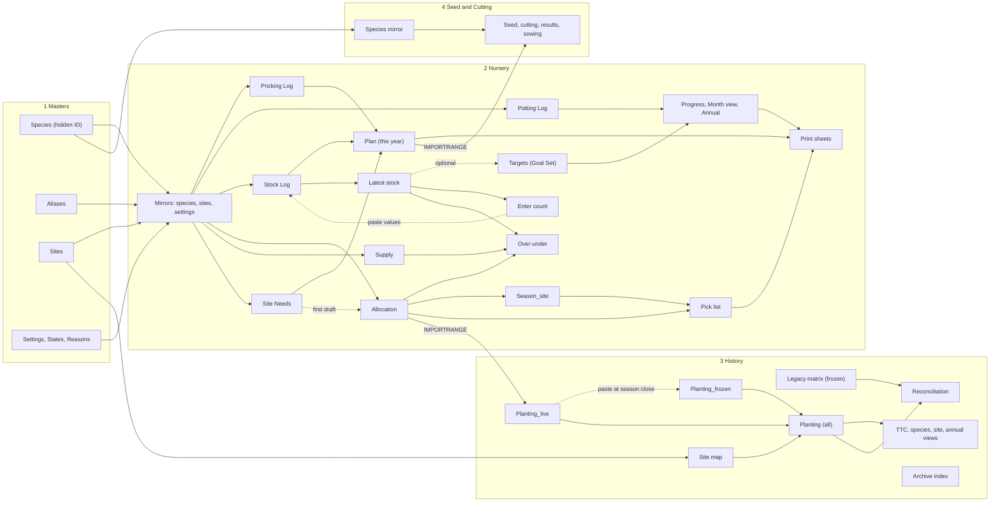

# 04b. If WRT stays in Google Sheets: the best version of the workflow (S4B)

Scope: the design if Sheets remain the main tool, assuming S4A's Species and Sites tables exist and using the log designs of `01c`, `01d`, `01e`. I opened no live Sheet. **Everything marked `[UNTESTED]` is from general knowledge of Google Sheets and must be tried on a copy first.** Assumptions as in `00_evidence_summary.md`.

## 1. The shape in one paragraph

Today: ten records, about 48 typed copies of the species list (`01a` §6), 35 retyped hops, a new workbook or tab per month, season and year. Tomorrow: **four workbooks**; six **append-only tables** that only ever gain rows; one Species list and one Sites list typed once; and every summary, print sheet and pick list **generated by formula** from keys, never from row positions. The seasonal "new form" becomes changing two cells and archiving a few values.

## 2. Design rules

1. **A fact is typed once.** A repeated figure is a formula or lookup (1,900 typed summary cells go, `DATA_SHAPE` §4).
2. **Long tables, not matrices.** A season, session or count is a row, never a column or tab. This kills the swapped header dates (44 of 50 headers, `01c` §1.5), the 13 copies of the species list and the 30 site columns.
3. **Look up by key, never by position.** `SUMIFS`, `QUERY`, `XLOOKUP`. No formula says "row 47 of that tab". Insertions then cannot make `#REF!` (six Autumn 2026 site sheets today).
4. **Entered and calculated columns are different things.** Calculated columns are protected, sit to the right, and fill themselves from one `ARRAYFORMULA` in row 1 (`={"Header"; ARRAYFORMULA(IF(A2:A="","",...))}`). `[UNTESTED]`
5. **Real dates, ISO display.** Store true dates, format `yyyy-mm-dd`, set each workbook's locale to New Zealand, and reject text with validation (between 2015-01-01 and today + 1). Production year, planting season and calendar year are *calculated* (August cut-off held once in `Settings`), never typed.
6. **Humans see words, IDs sit underneath.** Species and sites are picked by the names WRT uses. A hidden, protected `sp_id` or `site_id` column resolves the name through Species, then Aliases. A rename adds the old text to Aliases in the same edit (`01a` §9), so old rows keep resolving.
7. **Current and historical are separate files.** Wednesday typing cannot damage frozen history.
8. **Keep paper and the vocabulary.** V150, T28, PB3, Stage 2/3/4, "pricking out" and "potting on" stay. Print sheets are generated views in the order volunteers know.

## 3. How many workbooks: four

| # | Workbook | Holds | Who edits | Changes |
|---|---|---|---|---|
| 1 | **WRT Masters** | `Species`, `Aliases`, `Sites`, `Settings` (tray sizes, August cut-off, uplift default), `States`, `Reasons` | Nursery manager + one deputy; everyone else views | Rarely |
| 2 | **WRT Nursery** | All current work: logs, plan, allocation, views, prints | Named editors per tab (§7) | Weekly |
| 3 | **WRT History** | Frozen planting matrix and clean `Planting` table, site map, reconciliation, reports, archive indexes | Nursery manager only; staff view | Twice a year |
| 4 | **WRT Seed and Cutting** | Records 2 to 6 (collecting, seed log, cutting log, results, sowing list) | Propagation lead + one deputy; **restricted sharing** | Seasonally |

Not one: sharing is per workbook, so seed-source locations (36 columns in 32 files, `04g`) would sit beside everything volunteers and funders see. Not ten: each is another permission and link to repair. Masters apart: three consumers and two editors, so "who may change the species list" is a sharing setting. If four is too many, fold Masters into Nursery (three workbooks).

**Cross-workbook links: `IMPORTRANGE` only, one direction, one hub.** Masters flows out to the others as local **mirror tabs** (`Species (mirror)`, `Sites (mirror)`, `Settings (mirror)`), one import each. Dropdowns and lookups read the local mirror, as `01a` §8 advised, because validation lists work best on a same-file range `[UNTESTED]`. Each mirror has a check cell that turns red if the link breaks. Two other reads: Nursery `Allocation` (current season) into History, and `Plan` (targets only) into Seed. About eight imports in all; today there are none. Nothing flows out of Seed.

One finding changes the plan: by the ID-pattern rule in `scripts/WRT_SUMMARY_LINKS.md`, seven of the ten live records are probably **uploaded `.xlsx` files** opened in Sheets (medium confidence), and `IMPORTRANGE` may not read an unconverted `.xlsx` `[UNTESTED]`. So build new, native Google workbooks and paste in the current data. Do not retrofit the old files.

## 4. Tab map (arrows = formula reads, from source to reader; dotted = manual paste or optional)

## 5. The six append-only tables (one reconciled column set)

Rules: rows are only added; typos are fixed in place; version history is the audit trail (append-only cannot be enforced). Entered columns left, calculated columns right and protected. Species and site cells are dropdowns that **reject** anything not listed (`01c` rejects, `01a` warns; I reject in the entry logs because Species has a `One-off request` status and adding one is a 30-second owner edit, and warn only in the Seed workbook). 

| Tab | Entered | Calculated |
|---|---|---|
| **Pricking Log** (`01b` §2.5) | date, species, container (V150/T28), trays, group, note | `sp_id`, plants = trays × tray size (Settings), production year, month |
| **Potting Log** (`01c` §3) | date, species, from*, to*, qty, group, note (*blank = V150 to PB3) | `sp_id`, production year, month, counts_to_goal |
| **Stock Log** (`01d` §2.1) | date, type (COUNT / LOSS / BOUGHT_IN), species, state, qty, location, reason, supplier, status, note, source, flag | `sp_id`, available? (from `States`) |
| **Allocation** (`01e` §2.1), one table for *all* seasons | season, site, species, source, supply_status, required, allocated, pick_note, planted_qty, planted_date; blank `area`, `event_type` | `site_id`, `sp_id`, ready now (from `Latest stock`), over/under |
| **Supply** (`01e` §4) | season, species, source, supplier organisation, qty, status (planned / ordered / confirmed / received), status_date, note | `sp_id` |
| **Planting** (History; `01f` §2, `02` §2) | season, site, species, qty, source, confidence, quantity_basis, imported_from | `site_id`, `sp_id`, year, calendar year |

Reconciled: (a) Pricking and Potting are **two tabs with a matching spine**: trays versus plants, different people; merge later with an `activity` column if wanted. (b) `BOUGHT_IN` rows in the Stock Log and `Supply` rows overlap: `Supply` is the *plan and order* (status moves planned to received), the Stock Log row is *evidence of delivery* in a count and is optional once the next COUNT includes the plants. (c) `01e` and `01f` describe one table at two moments: Allocation holds the plan and the returned `planted_qty`; History's `Planting` holds the record. Blank `planted_qty` means unknown, never "same as allocated"; `confidence` is `recorded` or `allocation` accordingly (`01e` §5).

`Settings`/`States`: V150, T28-growing, PB3-growing, PB3-ready, T28-ready, with "counts as available" held only there (`01d` §2.2). Optional, after one clean March count is logged: with V150 stored without its T28 trays (`01d` §2.3), `Targets` can default the Goal Set to that count by formula, with a typed override and reason. `[UNTESTED]`

## 6. Generated views and print sheets

All read whole columns (`Log!A:A`), so new rows are included without editing a range. Pivots cannot join tabs, so lookups sit in view tabs (`01f` §3).

| View | Formula idea | Replaces |
|---|---|---|
| `Progress` | `SUMIFS` over Potting Log by `sp_id` and year, against `Targets`; every goal species shows, even with no sessions | Potting `Summary` |
| `Month view`, `Annual` | `QUERY(... pivot month)`; labels come from the data | 11 month tabs, typed `Annual` |
| `Latest stock` | per-**state** latest COUNT date with `MAXIFS`; sums of that date's rows (`01d` §2.3) | overwritten Master |
| `Over-under` | allocated vs **ready now**, **incoming**, **planned**, never summed (`01e` §4) | "Total Available" |
| `Plan` | need × (1 + uplift) + spares, rounded up to trays; last count and pricked-to-date beside it (`01b` §4) | pricking `Sheet2` |
| `Season_site` | targets, dates, guards; `allocated_total` = `SUMIFS` over Allocation | Collection Schedule, Plant Protection |
| `Planting (all)` | `={Planting_frozen; Planting_live}` (same columns) | typed season block |
| History views | species × season, site × species, year × season, class (K/C/S); TTC = filter on the looked-up `>5m` flag | `SUMMARY`, `CHART DATA`, `Trees that Count*` |
| `Reconciliation` | stated totals pasted *as reported* beside `SUM(Planting)` and the gap (`01f` §5) | four competing totals |
| `Control`, `Checks` | `Control` holds current production year and season (the only cells changed at rollover); `Checks` counts of unmatched species, future dates, blank IDs, repeated COUNT dates, `Less T28` vs T28 stock, site totals vs targets | nothing today |

**Print sheets** (in Nursery, print ranges set once): *Pricking* (species in the usual order, container, trays to go, blank "this session" box); *Potting* (species with To go above zero plus ten blank lines; trial two Wednesdays, `01c` §4); *Count form* (species, number, location, date, state tick); *Pick list*. The Pick list is one tab with two dropdowns (`season`, `site`) and a `QUERY` on keys (`01e` §3). To print every site at once, duplicate the tab once per site with the site cell fixed, then delete the copies at season close: the formula is identical, so no copy can point at the wrong column. `[UNTESTED]` Print order comes from a `print_order` column on `Species`, so sorting that tab cannot reorder the paper.

**Entry.** Most entry is "first empty row: date, species, number". The exception is the stock count (about 100 lines). `Enter count` shows species in paper order with date and state cells; a `FILTER` block builds log-shaped rows; the coordinator pastes values under the last Log row, and a banner warns if that date and state are already in (`01d` §2.4). No script. Allocation entry is by filter view per site, and a read-only species × site grid keeps the familiar picture. `[UNTESTED]`

## 7. Protection, sharing and what a sort breaks

**Who edits what** (editor sets on tabs; Sheets protection is a guard against accidents, not against a determined person):

| Area | Edit | View |
|---|---|---|
| Masters (all tabs) | nursery manager, deputy | all staff |
| Pricking, Potting, Stock logs, Targets | nursery coordinator, nursery manager (pricking also propagation lead) | staff |
| Site Needs, Plan, Season_site | operations manager, nursery manager | staff |
| Allocation, Supply | nursery manager (+ coordinator for `planted_qty`) | staff |
| History | nursery manager | staff; funders get PDFs or a published chart, not the file |
| Seed and Cutting | propagation lead, deputy | named people only |

Calculated columns, header rows, views and prints: whole-sheet protection, with only the dropdown input cells unprotected. 
**What breaks if someone sorts a tab** (the real risk with long tables):

| Tab type | Sorting one column | Sorting whole sheet | Defence |
|---|---|---|---|
| Log | **Scrambles rows** if only the selected column moves (species no longer match numbers); nothing flags it | Safe: each row moves intact, calculated columns recompute | Few editors; teach filter views (per-person, change nothing); protected cells may block sorting for non-owners `[UNTESTED]`; `Checks` shows monthly control totals typed from paper; version history is the recovery |
| View / print (formula output) | Sheets refuses to sort part of an array | Same | Whole-sheet protection |
| Masters | Row order changes; IDs and aliases move with rows, so lookups survive | Safe | Hidden ID column is in the same row; print order has its own column |
| Allocation | As Log | Safe | As Log; `site_id` and `sp_id` are in-row |
| Anything with row-position links | Breaks silently | Breaks silently | None exist in the new design (rule 3) |

Residual risk: Sheets cannot stop an editor sorting one log column. Hence few named editors and a quarterly dated copy.

## 8. Rollover: what the January and July "new form" steps become

| When | Today | Tomorrow (about 10 to 20 minutes each) |
|---|---|---|
| **January** (pricking list, propagation lead) | Copy last year's workbook, retype 98 species and targets | (1) Set `Control` year. (2) Paste last year's `Plan` decisions into `Plan_archive` as values. (3) Clear planned-target and reason cells. (4) Review `Checks`. (5) Print the Pricking sheet. |
| **March** (V150 count) | New file, new layout | Enter COUNT rows (state `V150`, T28 species flagged). Nothing new is created. |
| **July** (potting form) | New workbook, 13 species tabs, typed Goal Set | (1) Set `Control` year. (2) Archive last year's `Targets`. (3) Paste or compute the new Goal Set and Less T28 with a source note. (4) Print the Potting sheet. The Potting Log and `Progress` carry on. |
| **Each planting season** | New allocation workbook, 18 site sheets | Set `Control › current season`; add `Allocation` rows (draft from `Site Needs`); duplicate Pick list per site; after planting, fill `planted_qty`; at close paste `Planting_live` into `Planting_frozen` as values and delete the pick-list copies. |
| **Year end** | Typed summaries | Dated copy of each workbook; check `Reconciliation`; refresh the chart. |

## 9. Today's sheet → tomorrow's home

| Today | Tomorrow | Notes |
|---|---|---|
| Standard Annual Plant List MASTER › Sheet1 | `Site Needs` rows; species block to Masters | The disagreeing lists become tagged versions; old file archived |
| Plants Out › `Master Plant List`; names `.docx` | Masters `Species` (flags, names, status) | Docx archived; Notes' seven-place rule retired; `SUMMARY SITES` register becomes `Sites` |
| Forecast workbook (16 sheets) | `Site Needs` + look-ahead view | Not live today; do not import its `#REF!` roll-up |
| Pricking-out 2026-27 Sheet1, Sheet2 | `Plan` | Yearly tab, archived as values |
| Three pricking tally workbooks | `Pricking Log` + Pricking print | Goals only today; no history to import |
| Seed Sowing list | Seed workbook `Sowing` tab | "Projected potting" reads `Plan` |
| Seed collecting, seed, cutting, results records | Seed workbook, same tabs | Dates as true dates, species dropdown (warn); restricted |
| Potting On: 11 month tabs | `Potting Log` | Load 2026/27 only (20 lines) |
| Potting On: Summary, Annual, Goal tabs, weekly print | `Progress`, `Annual`, `Targets`, Potting print | Derived; do not migrate |
| `[name] Master` (targets) | `Plan_archive` | Reference only |
| V150 stocktake files (March) | `Stock Log`, state `V150` | Import 5 March counts later (`02` §3) |
| `Stocktake Master CURRENT` | `Stock Log` + `Latest stock` + Count form | 2026 columns flagged `date_nominal`; 23 older events go to History `Archive index` |
| Allocation Spring/Autumn 2026 masters | `Allocation` (long) + frozen old matrix in History | Unpivot once by script |
| 18 site print sheets | `Pick list` | |
| Collection Schedule, Plant Protection | `Season_site` | |
| Buy-in columns, QT plan, Paper4Trees forms | `Supply`, `Allocation` source = scheme | PDFs stay in Drive |
| Plants Out Master › `MASTER` | History `Legacy matrix` (frozen) + `Planting_frozen` (5,448 rows) | Imported once |
| SUMMARY SITES / PLANTS, CHART DATA | History views | Typed cells replaced |
| Trees that Count sheets | `TTC` view | Typed extracts stop |

## 10. Costs, limits and what I could not test

- **Setup:** about a week of building, a day each for the Masters and History imports (`02`), then a fortnight of parallel running. No scripts: WRT can maintain `SUMIFS`, `QUERY`, `XLOOKUP`, `MAXIFS` and `ARRAYFORMULA`.
- **Limits of Sheets:** no enforced append-only or per-row permissions; `IMPORTRANGE` needs a one-time grant and breaks if access is withdrawn; no tray traceability. None bites at WRT's volume (about 150 potting lines and 300 allocation rows a year).
- **`[UNTESTED]` list:** header `ARRAYFORMULA` with sorting; dropdown validation from a mirror range; reject-validation behaviour with a long list; `IMPORTRANGE` reading converted versus uploaded files; protected cells blocking sorts; `FILTER`-block paste-values; stacked `{A; B}` ranges across tabs; `MAXIFS` per state; duplicating pick-list tabs; alias lookup performance; PDF printing of a `QUERY` range.
- **Needs WRT first:** which Sheet is live, and whether records 9 and 10 are one workbook (decision 1); who owns Masters (2); site ID rulings (5); the trusted total and 2024 Slope Hill (4); what "ready" means for T28 (`01d` §5).
- **When to move on (Level C):** a true stock ledger by tray, role-based seed-source access, many simultaneous editors, or a TTC rule that needs an API. Until one of those appears, this design is Level A with a small Level B core (IDs, one import), and I recommend it.
