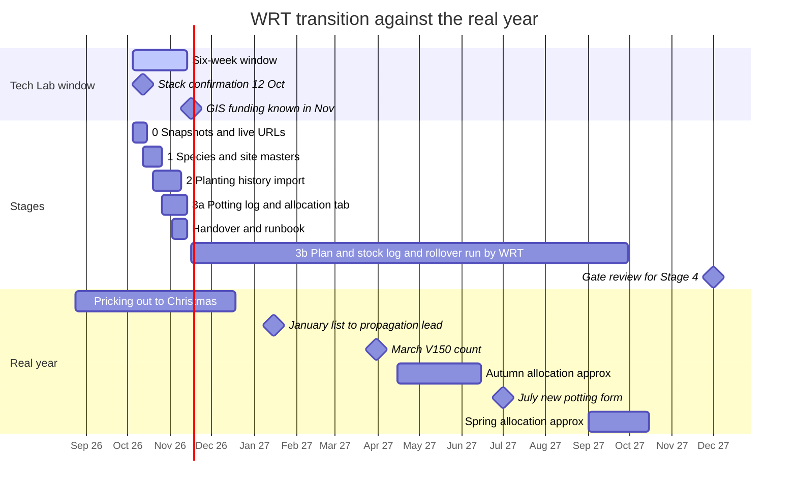

# 04e: Transition architecture (S4E, Phase 2)

Question: how can WRT move gradually from today's Sheets to cleaner, linked data, without a big-bang migration and without losing fifteen years of records?

Assumptions (as `00_evidence_summary.md`): the ten Google Sheets are live and match the export; volunteers keep paper and the nursery coordinator keys totals (second-hand, medium); nothing historical is edited in place. I opened no Sheets; Sheets mechanics (IMPORTRANGE, protection) are untested (medium). Roles, not names.

## 1. The shape of the answer

Five stages, each useful alone. Rules throughout: **add, never overwrite** (old tabs are protected and relabelled "superseded", never deleted); **no double entry** ("parallel" means the old view stays for comparison); **Sheets stay home until a gate says otherwise**. Stages 1 to 3 are Level A with a small Level B (IDs, one import); Stage 4 is Level C and optional. The safety net is a dated read-only copy of each record in a `Snapshots 2026-10` folder, plus version history.

## 2. Timeline (one diagram)

Bars marked "approx" are inferred from season names (low confidence). TTC timing is not in the evidence, so it is not drawn.

## 3. Stage by stage

### Stage 0: NOW

- **Exists:** the ten Sheets unchanged, the snapshot folder, and a one-page table of live URLs (decision 1), including whether records 8 and 9 are one workbook (they share a tab id).
- **Staff do differently:** nothing. **Frozen, parallel, rollback:** none needed.
- **Gate to Stage 1:** live URLs confirmed; species-list owner and deputy named (decision 2).
- **Who:** WRT confirms and names; Tech Lab snapshots.

### Stage 1: clean shared master data (species, sites)

- **Exists:** one new Sheet, `WRT Master Lists`: `Species` (append-only, hidden ID, `>5m` and threatened flags, Status), `Aliases` (from the 820-row census, uncertain rows proposed only), `Sites` (typed ID, mapped site, K/C/S class, landowner organisation), `Settings` (tray sizes 24 and 28). Contested pairs kept as two rows (`01a` §9).
- **Staff do differently:** "add a species in seven places" becomes "add a row at the foot of the Species tab and set its Status". The named owner rules on Status and the three `>5m` lists; two people edit, everyone else views.
- **Frozen:** the seven-place instruction in `Plants Out Master › Notes` is annotated "replaced". Live sheets keep typed species names this season.
- **Parallel:** a check column in live sheets (`OK / not on Master / alias of X`), the only live change in this stage.
- **Rollback:** delete the check column; nothing depends on the Master yet.
- **Gate to Stage 2:** contested pairs ruled or explicitly deferred (two rows either way); `>5m` disagreement (49/50/39) marked "to confirm"; Sites seeded with ID corrections proposed, not applied (decision 5).
- **Who:** Tech Lab builds (a day or two); the WRT owner rules (about 40 decisions).

### Stage 2: normalised history (then stock snapshots)

- **Exists:** `Planting history (clean)`, a new read-only Sheet: 5,448 rows (season, site, species, quantity, `confidence`, `imported_from`), a site-mapping tab and a `Reconciliation` tab (four stated totals beside `=SUM(quantity)`, with causes). 70.8% of records are high confidence; the 14.3% needing a ruling import flagged rather than wait (`02` §2). Later, once the Stock Log exists: seven stocktake events (`02` §3) and 2023-24 to 2025-26 potting sessions with a `date_precision` flag.
- **Staff do differently:** the operations manager browses history by site or species, not a 411-column matrix. Nothing weekly changes.
- **Frozen:** `Plants Out Master › MASTER` (protected; URL kept). Its `SUMMARY` and `Trees that Count` tabs stay, labelled derived. Spring 2026 is the first season never typed into MASTER: it goes into the new table from the allocation tab (Stage 3a). Rollback: type it into MASTER as well, once more.
- **Parallel:** one TTC report generated and compared with the typed sheet; 2020-22 and 2024 already match (`01f` §4).
- **Rollback:** delete the new Sheet. MASTER was never touched.
- **Gate to Stage 3b:** WRT picks the trusted all-time total or accepts "as reported" with differences shown (decision 4); decision 3 answered or left as the `confidence` flag; the 2024 Slope Hill pair (21% of plants) marked "to confirm".
- **Who:** Tech Lab runs the re-runnable scripts and builds Reconciliation. WRT answers the mapping questions.

### Stage 3: improved operational sheets

Split in two, because only part of it can meet a real event before handover.

**3a, inside the window (weeks 3 to 5), on live events:**
- **Potting-on workbook (record 7):** add `Species`, `Targets`, `Potting Log`, `Progress`, `Print sheet`; load the 20 lines already entered (dates corrected). From the next Wednesday, sessions go in the log only.
- **Spring 2026 allocation (record 9):** add the long `Allocation` tab, `Site pick list`, `Season_site`, and `planted_qty` from whatever paper exists. Old matrix kept frozen.
- **Stock Log (new Sheet):** built and trial-imported (2026 Master, five March counts); no live count yet.

**3b, after handover (WRT runs it):** Plan tabs in the pricking-out workbook (5b) before the January list; the Enter-count form for March; `Targets` paste in July; Autumn 2027 allocation from the same long table.

**What staff do differently (the point of the stage):**

| Moment | Today | After |
|---|---|---|
| January | copy the species block, retype targets, send the list | open the Plan tab, check calculated against planned, add a reason, print the list |
| Pricking out | paper tally; goals only in the sheet | print sheet from the Plan; one log row per species per session |
| Wednesday potting | find the month tab, type a dated column header | next empty row of the Potting Log; print "still to pot" from Progress |
| March count | type figures into a dated Master column | print the count form, paste rows into the Log, Master reads `Latest` |
| July | new workbook, 13 month tabs, retyped species | open `Targets`, archive last year as values, paste new goals; the log carries on |
| Spring/autumn allocation | retype stock, 30 site columns | pick a site, print its pick list, enter planted quantity after the day |
| TTC | copy totals into an extract | open the TTC pivot |

Volunteers see only paper, in familiar species order.

- **Frozen:** potting month tabs, `Summary`, `Annual`; the Spring 2026 matrix and old site sheets; dated stocktake tabs (the Master stays as the familiar face over `Latest`). Relabelled, protected, kept.
- **Parallel for one season:** potting totals compared with the old Summary at month end for Aug to Oct (one look); the Master tab duplicated before the March count; the generated Plants Out block compared once with a typed one; the first Plan compared with a typed list.
- **Rollback:** everything is added tabs, so revert to the old tab. The cost is retyping what was entered since. The Plan's fallback is the retained `Sheet1`/`Sheet2`.
- **Gate to Stage 4:** at least one full cycle run from the new sheets (January list, March count, July form, an allocation, a TTC extract) **and** evidence the Sheets are failing for a reason software fixes (section 8).
- **Who:** Tech Lab builds 3a, dry-runs 3b on copies, and writes a one-page runbook per Sheet. WRT runs everything after handover; the owner and deputy maintain.

### Stage 4: optional database or web app (Level C)

- **Exists:** the cleaned tables (Species, Sites, Planting, Stock Log, Allocation) loaded as CSV into an existing product (Terraware, Spriggo, SeedSource, tested first) or small bespoke software. A restricted seed-source table only if decision 6 allows.
- **Staff do differently:** only those who gain (coordinator, nursery manager). Volunteers stay on paper.
- **Frozen:** each Sheet becomes read-only archive on a season boundary after sign-off; URLs stay alive.
- **Parallel:** the app reads the Sheets (shadow) for one season before taking entry. **Rollback:** the Sheets stay the system of record until sign-off.
- **Gate:** stack and hosting agreed with council, licence in the MOU, a named maintainer, funding, the existing-tool test run on the narrow job (forecast to target, shortfall against pipeline), and section 8.
- **Who:** separately scoped, not inside this window; WRT owns the data.

## 4. The yearly calendar against the window

Window: early October to mid November 2026, six Wednesdays (7 Oct to 11 Nov).

| Real event | When | Inside window? | Can the transition touch it before handover? |
|---|---|---|---|
| Pricking out (volunteers) | late Aug to Christmas | yes | Lightly: print-sheet trial only if wanted; no new routine mid-season |
| Wednesday potting | weekly | yes, six sessions | **Yes.** Live Potting Log (3a) |
| Spring 2026 allocation record | live now | yes | **Yes.** Long table, pick list (3a) |
| PB3/T28 stocktake | twice a year or more | no fixed date | Build and trial-import only |
| January list to propagation lead | Jan 2027 | no | **No.** Dry run on a copy; WRT runs the real one |
| Seed collecting | Jan to Mar | no | **No.** Restricted Sheets untouched |
| March V150 count | about 31 March | no | **No.** Rehearse on past counts |
| Autumn allocation | about April to June (low confidence) | no | **No** |
| July new potting form | Jul 2027 | no | **No.** Rehearse on a copy |
| Spring allocation | about September | no | **No** |
| TTC reporting | not in evidence | unknown | Dry-run pivot only; TTC's fields unknown |
| Stack confirmation, GIS funding | 12 Oct; Nov | yes | Decisions, not events; Stage 4 stays closed until known |

Before handover the transition can complete Stages 0 to 2 and Stage 3 only where a live event exists (potting, Spring 2026 allocation). The rest is rehearsal: WRT staff, not Tech Lab, meet each real event first, so runbooks and rollbacks are part of the deliverable.

## 5. The ten live records

| # | Record | Keeps its URL? | Becomes | When |
|---|---|---|---|---|
| 1 | Forecast, 3 years ahead | Yes | Reference: need data copied once into the Plan's `Site Needs`; marked "not live" if WRT confirms (decision 16) | 3b |
| 2 | Seed collecting record | **Yes, untouched** | Stays restricted; nothing copies it | not before 4 |
| 3 | Seed records | Yes, after reconciliation (section 6) | Living log; non-sensitive columns may later feed a lots table | 2 later |
| 4 | Cutting records | Yes | Living log; same reconciliation check | 2 later |
| 5 | Seed and cutting results | Yes | Searchable archive (no row ID) | Stage 1 |
| 6 | Seed sowing list | Yes for 2026 | Fresh list yearly by design; "Projected potting" becomes a Plan lookup | 3b |
| 5b | Pricking-out list | Yes | **Becomes the Plan workbook.** Tabs added; `Sheet1`/`Sheet2` kept | 3b |
| 7 | Potting-on list | Yes | Gains the log and views; old tabs superseded | 3a |
| 8 | Nursery stocktake | Yes | Master tab turned into a view over `Latest`; dated tabs kept | 3b |
| 9 | Plant allocation list | Yes | Gains `Allocation` long table and pick list; matrix frozen | 3a |
| 10 | Plants Out Master | Yes | **Read-only archive** of MASTER after Stage 2. New seasons are generated from Allocation, never typed | 2 |

Only three new Sheets appear: `WRT Master Lists`, `Planting history (clean)`, `Stock Log`. If records 8 and 9 are one workbook, stock-to-allocation is a same-book lookup; if not, one IMPORTRANGE is the first cross-workbook link.

## 6. Reconcile the seed records before freezing anything

Phase 1 found the "archive" copy newer than the "master": `Archive Seed Records/_Seed records-[name].xlsx` has 927 rows to December 2025, the `_MASTER` copy 848 (`DATA_SHAPE.md`). Nobody has opened the live Sheet, and further `[name]` copies exist. Seed collecting (record 2) also has two copies; check cuttings in the same pass.

Rule: **freeze the copy that holds the most correct rows, never the one with the newest label, and freeze nothing until this is done.**

1. The propagation lead says which Sheet she types in today (version history shows the last edit).
2. WRT exports the live Sheet fresh. Tech Lab diffs it against the `_MASTER`, Archive and `[name]` copies on the lot key (tag plus era, `02` §6) using species, dates and amounts only: rows only in A, only in B, same key with different values. The script never reads the Site/Source or comment columns.
3. Rows found only in an older copy are appended to the live Sheet with a source note, the propagation lead confirming each batch. Nothing is overwritten; clashes are listed for her.
4. Only then are other copies protected and renamed "superseded, reconciled [date]", and the snapshot taken.

About a day of scripting and an hour of review (medium; the copies may not nest cleanly). It is Stage 1 work because it gates every later "archive" label.

## 7. Sensitive data across the stages

- **Seed-source locations, collection places, comments and the GPX** stay in their current restricted Sheets (records 2 to 4) through Stage 3. Nothing copies them: Master Lists, history, Stock Log and diff scripts exclude those columns by design.
- A seed-lot table, if built, holds tag, species and dates only. A restricted source table is Stage 4, after decision 6, with role-based access.
- Personal names, school contacts and the bank-account invoice stay in their source files. Group fields hold a group or "staff", never a person.
- Snapshots inherit their source's access; seed-record snapshots go in a restricted folder.

## 8. When Stage 4 is justified

After a full season at Level A, look for: name or row-position breakage recurring despite validation (`01b` §5); WRT wanting planting areas, event types or the Whitechapel 2029 test run for real (`01e` §6); several simultaneous editors, or role-based access to seed locations; an existing product covering batches and stock (then Stage 4 is adoption, not building); GIS funding needing a shared vocabulary. If none appears, Stage 3 is the right end-state, not a failure to finish.

## 9. Risks and open questions

- **Handover load.** Stage 3b falls on WRT after Tech Lab leaves. Mitigation: owner plus deputy, runbooks, 3a proving the pattern on two live events. Scope creep is the named risk (second-hand); the stage list is the scope.
- **Questions for WRT, in order:** live URLs (and whether 8 and 9 are one workbook); species owner and deputy; which seed-record Sheet is current; whether Spring 2026 may skip MASTER; TTC's timing and fields; whether the July form stays a yearly new file (this plan keeps the log continuous and `Targets` yearly, so the yearly decision stays visible, `03`).
- Not verified: Sheets behaviour, "approx" months, second-hand staff points.
