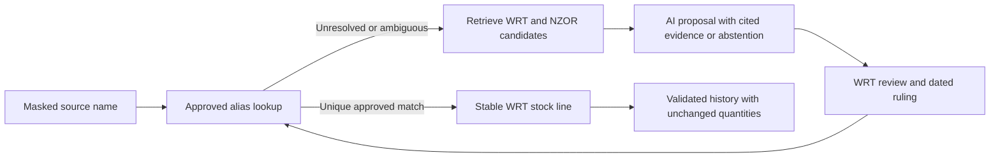

# What the audit answered

Audit date: 3 October 2026, Pacific/Auckland. This file records answers found in the app, generated data, source workbook and code. Staff decisions belong in QUESTIONS.md; interface problems belong in APP_CONFUSIONS.md. No app, data, source workbook or generator was changed, and no git commands were run.

**Assessment:** the app faithfully copies the selected MASTER snapshot and adds its quantities consistently. It is a useful reading copy with good source tracing. Its present “Resolved” status means no open mapping flag, rather than a verified planting outcome or fully completed register. Reliability is strongest at the source-cell and arithmetic layers; reporting scope, some site identities, stock names and completed outcomes still need WRT decisions. AI can help prepare evidence-backed name proposals, while approved aliases and import rules should remain deterministic.

## Coverage and limits

The browser walk covered the Overview; the required large sites, Paper4Trees and two small sites; all 11 history species returned by “Name needs a ruling”, plus Mānuka, Kohukohu, Tī kōuka and Weinmania racemosa; all 23 season cards; the five requested season detail pages; and Records with each of its nine review-question choices. At least three Source panels were read for each populated theme with three rows available. The nonnumeric theme has only its one TBC row; “Other check” has no rows. About the data was read before and after the walk. These browser observations are separate from the independent source checks below.

The contested-partner link for Ozothamnus fulvida opened a “Page not found” screen. The audit stopped at the original gauntlet's stop condition, reported the failure, and continued after the user explicitly authorised the expanded audit. The 404 is an app defect, not evidence that WRT's species information is wrong. Its proposed repair is recorded separately; nothing was repaired during this audit.

The served app was changing during the audit: a photo module appeared while question screenshots were being captured. One navigation briefly displayed a Next.js build error for the missing `@/data/species-photos.json` import. Capture stopped and the error was reported; a subsequent check showed that the file had appeared and the app had recovered. No audit code change repaired it. All 44 question screenshots were then completed on working pages. The initial page walk and source checks do not certify the newly added photo catalogue's identification, credits or coverage.

No regeneration, build or test suite was run. Existing tests were read, not presented as newly passing checks. Source checks used read-only Python, opened ZIP members in memory and printed bounded audit results. No workbook was extracted, saved or recalculated in Excel.

## Recorded plants and review status

The desktop presentation is coherent: large quantities, the consistent green/amber split, clickable season bars and the Source disclosure make it easy to move from an overview to evidence. The key presentation weakness is semantic: “resolved”, “went in”, “sites” and a displayed zero can imply stronger conclusions than the records support. The dark 2024 bars also dominate the small seasons. The specific wording and navigation proposals are in [APP_CONFUSIONS.md](APP_CONFUSIONS.md); the numbered screenshots supply the concrete views behind the questions. This was a desktop walk, without a separate mobile or full accessibility audit.

| Question answered | Answer and evidence |
|---|---|
| Does 140,068 mean verified trees planted, or surviving trees? | It is the sum of quantities in the history matrix. The records do not prove planting completion or survival. `/about-the-data#recorded` uses “recorded plants” and explains this limit. See [the page text](/Users/kyleg/wtr-app-tree-reforestation/app/about-the-data/page.tsx:71). |
| Are amber quantities included? | Yes. All 140,068 remain included: 95,778 on records with no review flag and 44,290 on 667 records needing review. Amber does not mean rejected plants, and green does not mean checked in the ground. [Every quantity enters the same total](/Users/kyleg/wtr-app-tree-reforestation/lib/wrt/queries.ts:20). |
| Why do the review-theme figures exceed the amber total? | Themes overlap. The same record can need a species ruling and a site confirmation. The eight populated themes contain 718 theme entries and 52,437 plants, but only 667 distinct flagged records and 44,290 plants. This is already explained on [About the data](/Users/kyleg/wtr-app-tree-reforestation/app/about-the-data/page.tsx:127), and [theme aggregation deduplicates themes within a record](/Users/kyleg/wtr-app-tree-reforestation/lib/wrt/queries.ts:253). Do not add question impacts together as if they were independent losses. |
| Why are there 5,449 records in the app but 5,448 in the reconciliation file? | 5,448 numeric source cells plus one nonnumeric TBC exception. The app counts both kinds as records. The producer's season reconciliation counts numeric cells. Spring 2025 therefore has 175 app records, of which 174 have a quantity. This is a scope difference, not a missing plant. |
| Does “High confidence” verify an outcome? | No. Confidence measures the matching of site/species information. The About page defines high confidence as “Site and species matched cleanly”. It is not a delivery, planting or survival assessment. See [confidence wording](/Users/kyleg/wtr-app-tree-reforestation/components/wrt/about/precision.tsx:14) and [the producer's confidence rules](/Users/kyleg/wtr-app-tree-reforestation/docs/planning/scripts/build_history_prototype.py:417). |
| Why no planting dates, volunteer counts, event types, photos or maps? | The imported history supplies species, site, season and quantity, with limited area detail in Autumn 2026. It has none of those event or spatial fields. Their absence from this app is answered at `/about-the-data#precision` and `#limits`; it is not a staff data-cleaning question. This does not establish that WRT has no such information elsewhere. |
| Why 38 sites alongside Paper4Trees? | There are 38 physical site groups and one order scheme. Paper4Trees is retained separately because it is a source heading with quantities, not a physical location. The overview [excludes schemes from its site count](/Users/kyleg/wtr-app-tree-reforestation/lib/wrt/queries.ts:297). Seasonal counts currently include all groups and can therefore label a scheme as a “site”; that wording belongs in APP_CONFUSIONS.md. |

The application's allocation explanation answers how it intends readers to interpret its numbers. The stronger historical claim behind that explanation still needs care. The source comparison below proves numerical agreement with allocation for many recent species; it cannot establish what staff checked before entering every season since 2015. Staff's own Summary of Records, item 10, describes a running tally of plants that went out and total plants planted, without explaining the entry method. A confirmation of actual versus planned quantities therefore remains a substantive question, rather than a request to explain the amber legend again.

## Season totals and gaps

The following totals were independently summed from the CSV and checked against the matching cells in the original workbook. All 23 agree. Numeric records exclude the one TBC exception.

| Season | Recorded plants | Numeric records | Plants needing review |
|---|---:|---:|---:|
| Autumn 2015 | 2,068 | 166 | 74 |
| Spring 2015 | 3,483 | 364 | 211 |
| Autumn 2016 | 3,176 | 224 | 237 |
| Spring 2016 | 4,331 | 410 | 568 |
| Autumn 2017 | 4,516 | 271 | 185 |
| Spring 2017 | 4,667 | 288 | 336 |
| Autumn 2018 | 4,589 | 219 | 210 |
| Spring 2018 | 3,458 | 184 | 298 |
| Autumn 2019 | 5,078 | 239 | 360 |
| Spring 2019 | 5,400 | 271 | 349 |
| Autumn 2020 | 996 | 49 | 15 |
| Spring 2020 | 7,572 | 320 | 493 |
| Autumn 2021 | 5,133 | 215 | 253 |
| Spring 2021 | 5,356 | 201 | 582 |
| Autumn 2022 | 5,869 | 225 | 420 |
| Spring 2022 | 5,014 | 204 | 374 |
| Autumn 2023 | 4,886 | 178 | 467 |
| Spring 2023 | 5,720 | 233 | 641 |
| Autumn 2024 | 13,657 | 290 | 7,296 |
| Spring 2024 | 29,826 | 331 | 25,543 |
| Autumn 2025 | 4,469 | 190 | 1,033 |
| Spring 2025 | 6,248 | 174 | 3,704 |
| Autumn 2026 | 4,556 | 202 | 641 |
| **All** | **140,068** | **5,448** | **44,290** |

Autumn 2020's six site groups are Gorge Road area (150), Lake Hayes (205), Slope Hill (150), Arrowtown and Bush Creek (125), Whitechapel (225), and Peace Park and Frankton (141). These total 996. The season has 29 species and 49 records; only three records carrying 15 plants have an amber flag. The median season has 13 recorded groups. These counts are answered; whether the small season is complete is not. No cause, including a disruption to planting, can be inferred from these counts alone.

Spring 2026 is absent from MASTER's season headers and from the imported history. The app's empty card says “Not in the master workbook yet”; it is not a recorded zero. A separate Spring 2026 allocation workbook exists, but importing it would extend the app's present source scope. Which completed figures should enter the history remains a staff/source decision.

Slope Hill's two large columns are in different seasons. Coronation has 7,000 plants on 16 Autumn 2024 records, including `MASTER!MG24`. HGF has 22,000 plants on 22 Spring 2024 records, including `MASTER!MU24`. The example question in the gauntlet prompt should not be copied as if all 29,000 were in Spring 2024.

| Scope | Current total | If only the relevant disputed column is excluded |
|---|---:|---:|
| Autumn 2024, all sites | 13,657 | 6,657 without Coronation |
| Spring 2024, all sites | 29,826 | 7,826 without HGF |
| All history | 140,068 | 118,068 without HGF; 133,068 without Coronation; 111,068 without both |

Ordinary Slope Hill records also appear in those seasons: its full site totals are 8,000 in Autumn 2024 and 23,132 in Spring 2024. Slope Hill's all-time site total is 42,478 on 244 records, with 33,983 plants on 99 flagged records. A full site figure and the two disputed-column figure have different scopes.

## Independent source-to-app lineage

The original export was available inside [the source ZIP](</Users/kyleg/Downloads/___ALL Plant Lists-20261003T025844Z-1-001.zip>). The audited member is `_ALL Plant Lists/_MASTER Nursery records and templates/_JMN Plants Out Master.xlsx`. It is **460,012 bytes**, with SHA-256:

```text
2df0e137ccf80e9d69ba164cd9d46b77136368db7ffedb9a7f8fe584c3154033
```

This exactly matches [the producer's recorded source hash](/Users/kyleg/wtr-app-tree-reforestation/docs/planning/scripts/build_history_prototype_output.txt:4). The ZIP also contains an archive workbook with a different hash and size. It was not substituted for the current member.

The source-to-view path is:

1. The producer reads MASTER's season/site headers and rows 8–106, plus a site register and previously proposed name mappings. It reads cached values and formulas separately. [Input paths and fixed bounds](/Users/kyleg/wtr-app-tree-reforestation/docs/planning/scripts/build_history_prototype.py:47), [workbook reads](/Users/kyleg/wtr-app-tree-reforestation/docs/planning/scripts/build_history_prototype.py:343), [record extraction](/Users/kyleg/wtr-app-tree-reforestation/docs/planning/scripts/build_history_prototype.py:389).
2. Positive numeric cells become records; blanks and zero cells are skipped. The text cell becomes a flagged record without a quantity. Site/species proposals and review notes are attached before CSV output. [Quantity handling](/Users/kyleg/wtr-app-tree-reforestation/docs/planning/scripts/build_history_prototype.py:394).
3. The app validates and loads five generated CSVs. It never opens XLSX files. It constructs species, places, parcels and records, while retaining source workbook, sheet, cell and original strings. [Validation](/Users/kyleg/wtr-app-tree-reforestation/lib/wrt/csv/validate.ts:74), [CSV repository](/Users/kyleg/wtr-app-tree-reforestation/lib/wrt/csv/csv-repository.ts:127).
4. A shared query layer adds every record's quantity once, then separates green and amber quantities. Site, species, season and filtered Records pages all use this layer. [Quantity splits](/Users/kyleg/wtr-app-tree-reforestation/lib/wrt/queries.ts:20), [record filters](/Users/kyleg/wtr-app-tree-reforestation/lib/wrt/queries.ts:422).
5. Source panels show that retained origin and humanised review notes. [Source rendering](/Users/kyleg/wtr-app-tree-reforestation/components/wrt/records.tsx:16).

### One record traced through the whole path

The original `MASTER!OP106` is a typed numeric **19**, not a formula. Its headers are Spring 2025, Quail Rise and site number 29; `MASTER!D106` says Cyathoides juniperina. The producer gives it the proposed species entry kept separately from Leptecophylla juniperina, marks the contested pair for review, and retains the note that row 106 is outside the grand-total range.

[The resulting CSV row](/Users/kyleg/wtr-app-tree-reforestation/docs/planning/prototype/planting_history.csv:5215) contains exactly that quantity and origin. The loader retains quantity 19, a present-quantity flag, Quail Rise and Spring 2025. The query split includes the 19 in both the total and amber portion. The original `MASTER!PA107` Spring 2025 total includes it; `MASTER!PY107 = SUM(PY4:PY105)` excludes it. This explains the 19-plant grand-total difference without inventing a correction.

The neighbouring contested-species cell `MASTER!OP50` contains the text `TBC `, with a trailing space. [Its CSV row](/Users/kyleg/wtr-app-tree-reforestation/docs/planning/prototype/planting_history.csv:5203) has an empty quantity. The loader represents it internally as zero **with `hasQuantity = false`**; the record table displays a dash. It contributes no numeric quantity but does contribute one flagged record. That implementation zero is not evidence that no plants went out. The Source wording “Counted as 0” is liable to obscure this distinction and is listed as an app confusion.

### Checks actually performed

| Independent check | Result |
|---|---|
| Raw source extent | MASTER has 108 rows and 442 columns. Its read-only XLSX dimension metadata is absent, so dimensions were calculated in memory before scanning. |
| Extraction scope | 386 site columns with a season and site header; 23 TOTAL columns; 99 species rows, 8–106. |
| Every positive source cell against CSV | 5,448 cells, total 140,068; zero missing source cells, zero extra numeric CSV cells, zero quantity differences, zero duplicated source cells. This compared cell sets and individual quantities, not just the grand sum. |
| Original species text | Identical for all 5,449 generated rows. |
| Other in-scope cell types | 397 zero cells; no negative quantities, no fractional quantities, no Excel error cells; one text cell, OP50. |
| Quantity formulas and missing caches | One in-scope quantity formula, `MASTER!OZ77 = 5+7`, cached as 12. No missing formula cache in the quantity matrix. |
| MASTER formulas against their caches | A constrained evaluator for SUM, cell/range references and ordinary arithmetic evaluated all 2,636 MASTER formulas from current cached inputs. All matched; none required unsupported functions, and no formula cache was missing. |
| Seasonal controls | All 23 independently summed season totals match the original TOTAL cells and the stored reconciliation values. |
| Per-species all-time control | Cached `MASTER!PY8:PY106` adds to 140,068. Each MASTER species row's recorded quantities agree with its PY total. |

Formula-cache agreement is stronger than reading the cached number alone, but this audit did not run Excel or another full spreadsheet calculation engine. The workbook has `fullCalcOnLoad = true`. This check covered MASTER, not every formula in every worksheet, and does not certify future cache freshness.

### Values outside the extraction bounds

Three cells above the species rows contain an isolated 72: `MASTER!NR7`, `MASTER!ON7` and `MASTER!PJ7`, under Autumn 2025, Spring 2025 and Autumn 2026. All three columns map to Jardine Park reference gardens. They have no species label, no nonzero species quantities in rows 8–106, and a row-107 total of zero. The cells have no comment or merged label; no MASTER formula references them. Their meaning is not stated in the workbook.

These are **not established missing planting records** and must not be added as 216 plants. Their omission follows the explicit species-row extraction scope. A future extraction audit should report such unlabelled numeric cells for a source owner to classify. At the bottom of MASTER, row 108 contains only `PY108`, a formula; no additional species records were found below row 106. The excluded PY/PZ columns contain all-time/reporting figures, not new site-season records.

## Grand-total arithmetic, and corrections to its explanation

| Original workbook control | Value | Difference below row sum | What the source proves |
|---|---:|---:|---|
| `MASTER!PY107` | 140,049 | 19 | `SUM(PY4:PY105)` excludes the final species row. |
| `MASTER!PY8:PY106`, added | 140,068 | 0 | All species row totals include that final 19. |
| `MASTER!PZ107` | 137,273 | 2,795 | `SUM(PZ105+1772)` uses a typed arithmetic chain, rather than summing the history matrix. |
| `SUMMARY SITES!BC3` | 139,948 | 120 | The 2025 per-site annual cells add to 10,597, while autumn and spring detail add to 4,469 + 6,248 = 10,717. |
| `SUMMARY PLANTS!AW4` | 135,413 | 4,655 | This summary stops at 2025; its Autumn 2025 detail totals 80 less than MASTER, and the final species has 19 in Spring 2025 but no annual or all-time formula. |

The arithmetic differences are answered. Which quantity WRT quotes, and which plants it intends to include, remain staff decisions.

Two phrases in the app's stored cause for SUMMARY PLANTS need correction. `SUMMARY PLANTS!AS4` is **not a typed subtotal**: its formula is `sum(AS5:AS103)` and its detail cells actually sum to 4,389, 80 short of MASTER's 4,469. Also, `SUMMARY PLANTS!AT104` contains 19, but `AU104` and `AW104` are blank. Extending `AW4`'s `SUM(AW6:AW103)` to row 104 would therefore not recover the 19 by itself; the missing annual/all-time calculation must also be addressed. The net decomposition **4,556 + 80 + 19 = 4,655** is correct, but its present explanation is incomplete. [The cause is hardcoded in the producer](/Users/kyleg/wtr-app-tree-reforestation/docs/planning/scripts/build_history_prototype.py:534), then displayed from the generated CSV.

Matching grand or season totals also does not prove that the original summary's species mix is correct. Exact-name comparisons found differing species values in **11 of the 22 SUMMARY PLANTS seasons**: ten have cancelling differences with a net zero, and Autumn 2025 is 80 short. Spring 2015, for example, puts 19 at `SUMMARY PLANTS!F85` under Prumnopitys ferruginea and zero at `F86` under Prumnopitys taxifolius; MASTER has zero at `AP87` and 19 at `AP88`. Spring 2019 has 26 differing species values with a net zero and gross absolute difference of 650.

This is evidence of drift in the upstream summary, not an app import error: the app reads MASTER and the source-cell comparison passed. “All 23 seasons match” proves scalar season totals, not the accuracy of every upstream reporting sheet or the number of plants physically planted.

## Allocation versus completed outcomes: proven and unproven

The original Spring 2025 and Autumn 2026 allocation files were also opened in memory. Comparing exact normalised species names reproduced [the existing detailed lineage results](/Users/kyleg/wtr-app-tree-reforestation/docs/discovery/05_lineage_edges.csv:21):

| Comparison | Aligned species names | Nonzero species compared | Equal values |
|---|---:|---:|---:|
| Spring 2025 allocation `N6:N105` against MASTER `PA8:PA105` | 97 | 54 | 54 |
| Autumn 2026 allocation `M6:M119` against MASTER `PW8:PW105` | 97 | 60 | 58 |

Autumn 2026 differs for Podocarpus totara (allocation 1, MASTER 0) and Carpodetus serratus (allocation 29, MASTER 28). These results do not support repeating the planning prose's “98/98” or “96/98” as if every species was independently aligned and checked. The detailed discovery table describes its denominator more carefully: only common species with a nonzero value in either source enter that comparison.

The close agreement supports the interpretation that allocation fed the history. It does not, on its own, prove how staff entered the numbers, whether they checked deliveries/plantings before entry, why the two recent values differ, or whether the same process held across all earlier seasons. The app should retain “recorded plants” while staff confirm the basis; source mapping confidence should remain separate from outcome verification.

## Reliability gaps and proposed checks

These are proposals for later work. They were not applied during the audit.

| Current behaviour or gap | Why it matters | Proposed improvement |
|---|---|---|
| Producer paths are fixed under `/home/claude`; the README's bare regeneration command cannot find the current Mac source/layout. [Paths](/Users/kyleg/wtr-app-tree-reforestation/docs/planning/scripts/build_history_prototype.py:47). | Re-running in this checkout is not portable or self-contained. | Accept explicit input/output paths; document the source ZIP member and required mappings; record their hashes and the generator version. |
| Row bounds and header rules are fixed; blank caches are treated like blank cells. [Bounds](/Users/kyleg/wtr-app-tree-reforestation/docs/planning/scripts/build_history_prototype.py:55), [skip logic](/Users/kyleg/wtr-app-tree-reforestation/docs/planning/scripts/build_history_prototype.py:394). | A future species below row 106, unlabeled numeric column, malformed season, or formula without a cache could disappear from the imported history. None was found among the current valid species records. | Scan beyond expected bounds and report every unclassified data-bearing cell; reject malformed headers and missing/error caches before publishing output. |
| Most producer self-check failures print `FAIL` after CSVs have been written. [Output precedes checks](/Users/kyleg/wtr-app-tree-reforestation/docs/planning/scripts/build_history_prototype.py:442), [checks](/Users/kyleg/wtr-app-tree-reforestation/docs/planning/scripts/build_history_prototype.py:558). | A failed run can leave apparently usable output, with no failing exit status for most checks. | Build records in memory, assert all invariants first, then publish the complete file set atomically. |
| The producer's “every numeric cell once” check compares sums. | Missing and duplicated equal quantities can cancel. | Compare exact source-cell sets, multiplicity and per-cell quantities, as this audit did. Retain independent totals as an additional check. |
| Reconciliation numbers are parsed with `Number(value) || 0` and trusted at runtime. [Parsing](/Users/kyleg/wtr-app-tree-reforestation/lib/wrt/csv/csv-repository.ts:309). | Malformed values can become zero; a stale reconciliation CSV can display a healthy result unrelated to newly supplied records. Current files agree. | Validate finite integers, required cells and unique season labels, then recompute generated totals/differences from loaded records and refuse an inconsistent file set. |
| Record validation allows numeric zero and warns rather than rejects fractional quantities; it does not itself validate populated source strings/cell syntax. [Validation](/Users/kyleg/wtr-app-tree-reforestation/lib/wrt/csv/validate.ts:95). | It is more permissive than the producer's positive-whole-cell contract. Existing fixture tests cover some of these invariants after loading. | Enforce the documented contract, require well-formed source references and validate uniqueness of source workbook/sheet/cell as well as record identifiers. |
| Species and site mappings use Maps that can overwrite repeated keys. [Species map](/Users/kyleg/wtr-app-tree-reforestation/lib/wrt/csv/csv-repository.ts:189), [site map](/Users/kyleg/wtr-app-tree-reforestation/lib/wrt/csv/csv-repository.ts:211). | The current header-only site lookup loses the producer's typed/proposed-number distinctions. Current duplicate header groups retain the same proposed site name, so no wrong current parcel name was established. | Reject conflicting keys; use the appropriate compound site key or put the resolved site name on each history row. |
| Review themes are inferred from phrases inside prose notes. [Classifier](/Users/kyleg/wtr-app-tree-reforestation/lib/wrt/csv/csv-repository.ts:52). | A harmless wording change can move a record to “Other check” or change a filter's coverage. | Store explicit note kind and review theme, and validate complete classification independently of display wording. |
| “Site with no WRT number” includes only actionable notes, while many provisional sites are FYI. | A resolved flag does not establish numbering completeness. | Expose all provisional sites through a separate structural filter; keep identity confirmation and number assignment distinct. See the site evidence and questions in the other reports. |
| The repository is cached for the server process; `loadedAt` is the load time, not the source export time. [Cache](/Users/kyleg/wtr-app-tree-reforestation/lib/wrt/csv/csv-repository.ts:339), [timestamp](/Users/kyleg/wtr-app-tree-reforestation/lib/wrt/csv/csv-repository.ts:324). | Editing CSVs need not refresh an already running app, and a load timestamp cannot establish the freshness of the underlying workbook. | Publish and validate a dataset manifest with export/generation time and hashes; state the supported refresh/restart process. |
| Existing tests compare the real CSV fixture with expected totals and check aggregate coherence. [Reconciliation tests](/Users/kyleg/wtr-app-tree-reforestation/tests/repository.test.ts:111). | Useful fixture regression checks do not independently verify the XLSX, physical outcomes, every possible future input, or route navigation. | Retain these checks and add source-cell coverage, malformed/stale reconciliation fixtures, missing-cache/boundary cases and browser checks for every generated internal link. |

## A reproducible read-only check

The following command reads the original source member and CSV into memory, then asserts exact cell coverage, quantities and original species text. It writes no workbook or generated CSV. It uses the bundled Python runtime found through `load_workspace_dependencies`; `-B` prevents Python bytecode files. It intentionally does not invoke the producer's `main()`, whose output paths are outside this audit's allowed folder.

```bash
cd /Users/kyleg/wtr-app-tree-reforestation
/Users/kyleg/.cache/codex-runtimes/codex-primary-runtime/dependencies/python/bin/python3 -B - <<'PY'
import csv, hashlib, io, re, zipfile
from collections import Counter
import openpyxl

archive = '/Users/kyleg/Downloads/___ALL Plant Lists-20261003T025844Z-1-001.zip'
member = '_ALL Plant Lists/_MASTER Nursery records and templates/_JMN Plants Out Master.xlsx'
with zipfile.ZipFile(archive) as z:
    source = z.read(member)
assert hashlib.sha256(source).hexdigest() == '2df0e137ccf80e9d69ba164cd9d46b77136368db7ffedb9a7f8fe584c3154033'
book = openpyxl.load_workbook(io.BytesIO(source), read_only=True, data_only=True)
sheet = book['MASTER']
sheet.calculate_dimension(force=True)
matrix = list(sheet.iter_rows(min_row=1, max_row=sheet.max_row,
                              max_col=sheet.max_column, values_only=True))
columns = [j for j in range(6, sheet.max_column)
           if matrix[0][j] and matrix[3][j] not in (None, '')
           and str(matrix[3][j]).strip().upper() not in ('TOTAL', 'GRAND TOTAL')]
raw = {}
for row in range(8, 107):
    for col in columns:
        value = matrix[row-1][col]
        if isinstance(value, (int, float)) and not isinstance(value, bool) and value > 0:
            cell = openpyxl.utils.get_column_letter(col+1) + str(row)
            raw[cell] = value
with open('docs/planning/prototype/planting_history.csv', newline='') as f:
    records = list(csv.DictReader(f))
numeric = [r for r in records if r['quantity'] != '']
assert len(raw) == len(numeric) == 5448
assert set(raw) == {r['source_cell'] for r in numeric}
assert all(n == 1 for n in Counter(r['source_cell'] for r in records).values())
assert all(float(r['quantity']) == raw[r['source_cell']] for r in numeric)
assert all(r['species_original'] == str(matrix[int(re.search(r'\d+', r['source_cell']).group())-1][3])
           for r in records)
assert sum(raw.values()) == sum(float(r['quantity']) for r in numeric) == 140068
assert len(records) == 5449
print('Exact source cells, quantities and species text agree: 5,448 numeric records / 140,068 plants; one text exception.')
PY
```

This deliberately checks fidelity to the specified source snapshot. It cannot decide whether that snapshot reflects completed plantings, whether a proposed name is right, or which total WRT should publish.

## Site registration: answers beyond the amber filter

The source register's official numbers are in `SUMMARY SITES!A4:A82`; column B is blank. The Python reader uses A correctly. Earlier discovery documents citing B have a documentation error, not proof of an incorrect import. Number clashes were checked against the original workbook and agree with the app's notes.

The complete provisional-site inventory is larger than “Site with no WRT number” suggests:

| Site | Records | Recorded plants | Amber plants | What the supplied register answers |
|---|---:|---:|---:|---|
| Slope Hill HGF | 22 | 22,000 | 22,000 | Named at C35; number A35 blank |
| Walter Peak Station | 28 | 496 | 15 | Named at C12; number A12 blank |
| Shotover Rotary Track | 38 | 400 | 0 | Named at C64; number A64 blank |
| Little Difference | 22 | 200 | 200 | No matching row |
| Paererewa | 15 | 118 | 118 | No matching row |
| Skippers – DOC | 10 | 110 | 0 | Named at C24; number A24 blank |
| Kiwi Park | 8 | 105 | 0 | Named at C68; number A68 blank |
| Bridesdale | 6 | 80 | 0 | No matching row |
| Arrowtown Preschool | 8 | 80 | 80 | No separate row; possible existing 13A needs confirmation |
| Matakauri Wetlands | 8 | 80 | 0 | No matching row |
| Kingsview | 3 | 25 | 0 | Named at C69; number A69 blank |
| QLDC Tohu | 1 | 4 | 0 | No matching row |
| **Total** | **169** | **23,698** | **22,413** | |

Of the eight additional small sites beyond HGF and the three already flagged under this theme, 101 records carrying 1,285 plants are resolved. Walter Peak has a further 15 amber plants for an unrelated species issue. A name already present in the register answers whether WRT recognised that site; assigning an official number is still a decision. For Bridesdale, Matakauri Wetlands and QLDC Tohu, even the registration category needs confirmation.

The five number clashes cover 179 records and 14,915 plants: Coronation 7,000; Welcome Forest 4,575; Slope Hill Road 3,132; Akarua Corner 135; Derby Street Reserve 73. All are amber. Number corrections alone preserve quantities. “Uncertain site” covers 43 records and 370 plants: 1 Mile 165, unknown Shotover parcel 130, Rapley Close 40, and Gorge Rd Wetlands / QPS 35. Rapley's source uses old number 10, which the proposed mapping translates to current number 16; the source did not directly say 16.

The 49 cleaned Shotover records carry 377 plants: 247 assigned to registered part 28A, and 130 whose part remains unknown. Their saved headings are already masked. No removed personal name was observed in the generated output; the staff question concerns whether the cleaned site identity is right.

## Species names: what the existing validation really does

The species preparation starts with a census of 820 distinct raw-name variants across source types. It excludes 91 non-species entries and one free-text note, leaving 728 alias entries: 668 mapped and 60 unassigned. It proposes 164 species entries; 95 are represented in this history, including the TBC-only Leptecophylla entry. The other 69 have no history records. These are different object types and scopes, rather than four counts of independently verified botanical identities. Evidence is in [source variants](/Users/kyleg/wtr-app-tree-reforestation/docs/discovery/04a_species_variants.csv), [alias proposals](/Users/kyleg/wtr-app-tree-reforestation/docs/planning/prototype/species_crosswalk.csv), and [proposed species](/Users/kyleg/wtr-app-tree-reforestation/docs/planning/prototype/species_master_proposed.csv).

All 5,449 current history strings join through exact aliases. No current fallback-name join or species mapping discrepancy was found. The visible names then pass through a separate [display-name overlay](/Users/kyleg/wtr-app-tree-reforestation/lib/wrt/display-names.ts), so a polished label does not establish that the source register or nursery stock was corrected.

| Naming issue | Scope in this history | What the files can answer |
|---|---|---|
| Carex maorica / Carex secta | 51 records / 4,059 plants | 56 under maorica, 4,003 under secta; separate source rows |
| Leonohebe / Veronica cupressoides | 70 / 842 | 181 under Leonohebe, 661 under Veronica |
| Ozothamnus group | 61 / 811 | 727 under vauvilliersii, 84 under leptophyllus; fulvida has no history records |
| Olearia nummularifolia and its proposed variety | 7 / 89 | Variety is in the proposed catalogue, with no history records |
| Veronica hectorii and demissa | 9 / 75 | Demissa is in the proposed catalogue, with no history records |
| Carmichaelia group | 3 / 25 | Two proposed racemosa partners have no history records |
| Cyathoides / Leptecophylla juniperina | 2 / 19 plus an unknown quantity | One numeric 19 and one TBC cell, both at Quail Rise in Spring 2025 |
| **Seven contested groups** | **203 / 5,920 plus the unknown quantity** | All are flagged; grouping and stock identity remain open |

There are 25 proposed species marked as needing a decision in the whole catalogue; eleven occur in this history. The browser's eleven-name filter is therefore correctly narrower than the proposed catalogue. Six visible partner links target five different species with no history. All five targets were followed and returned “Page not found”. Their absence from the history explains the route failure, without answering the stock-identity question.

The macron overlay affects 20 species used in the history: 1,509 records and 38,762 plants, including 15,168 amber plants. Their leading display labels are Pūrei, Mākaka, Putaputawētā, Karamū, Tī kōuka, Pōkākā, Kōtukutuku, Kāpuka, Mānuka, Rōhutu, Rātā, Pōhuehue, Kaikōmako, Mānatu, Halls tōtara, Mountain tōtara, Mataī, Kōwhai, Tūrepo and Kāmahi. Some secondary labels also gain macrons, such as Southern rātā on the Rātā entry. This is a 20-species scope, rather than exactly twenty changed strings.

The four common-name cleanups cover 529 records and 17,281 plants, including 6,393 amber plants: Scented tree dasiy → Scented tree daisy; Tree fuscia → Tree fuchsia; Ribonwood → Ribbonwood; Toe toe → Toetoe. Recognising a spelling correction is straightforward; selecting the leading name that WRT wants is a separate decision.

Kohukohu was copied from WRT's Māori-name field, alongside Black matipo and the alias Kohuhu. It was not invented by the app. NZPCN lists kohukohu, kōhūhū and black matipo for Pittosporum tenuifolium. That answers whether Kohukohu is a plausible common name; it does not pick WRT's preferred label. [NZPCN species account](https://www.nzpcn.org.nz/flora/species/pittosporum-tenuifolium/)

Weinmania racemosa remains the source handle, with a spelling suggestion and Weinmannia aliases available. Its eleven records carry 58 plants, with no review flags. Mānuka's 109 records carry 2,182 plants, including 148 amber; a plain “manuka” browser search finds that macron-labelled entry. These show how source spelling, aliases, display labels and review status operate independently.

### Current defects and future naming risks

| Finding | Current effect or limit | Proposed change |
|---|---|---|
| IDs are assigned by sorted name position. [Generator](/Users/kyleg/wtr-app-tree-reforestation/docs/planning/scripts/species_crosswalk.py:272). | An added earlier name can shift later SP numbers, making future rulings or stored references unstable. | Give every WRT stock line a persistent ID; version changes to names and relationships. |
| Alias-level uncertainty is not fully propagated. [Importer](/Users/kyleg/wtr-app-tree-reforestation/docs/planning/scripts/build_history_prototype.py:191). | Twelve uncertain aliases belong to six otherwise unflagged species. None occurs in this history, so this is a future import risk. | Carry explicit alias and species decision flags, independently of the wording of a note. |
| Import and browser search normalise Unicode differently. [Import](/Users/kyleg/wtr-app-tree-reforestation/docs/planning/scripts/build_history_prototype.py:177), [search](/Users/kyleg/wtr-app-tree-reforestation/lib/wrt/text.ts:17). | Import turns Mānuka into `m nuka` and Tī kōuka into `t k uka`; search folds them correctly. Current source names lack macrons, so the current joins are unaffected. | Use one tested Unicode-aware normalisation rule, with original text retained. |
| Literal escape sequences survive display cleaning. [Cleaner](/Users/kyleg/wtr-app-tree-reforestation/lib/wrt/text.ts:33). | 142 aliases across 75 history species contain literal `\t` or `\u00a0`; some appear on screen. | Decode the known export escapes for display and matching; preserve the raw exported value separately. |
| Lexical match confidence looks like name approval. | Exact matching can give a high score to a misspelling. No calibrated accuracy rate or staff approval follows from that score. | Show matching evidence, botanical evidence and WRT approval as separate fields. |

### Botanical reference check

An exploratory screen queried all 164 proposed handles and the ten existing spelling suggestions against the official NZOR service. On the audit date, 129 handles had exact scientific-name hits with no differing accepted label, six had at least one differing accepted-name relationship, and 29 had no exact hit. **The 29 are not 29 proven errors.** Qualifiers, ranks, ambiguous identities and spelling can all prevent a literal hit. This was a name-resolution screen, not a full expert review of every taxon. [NZOR usage guidance](https://nzor.org.nz/how-can-i-use-nzor), [official service documentation](https://manaakiwhenua.atlassian.net/wiki/spaces/NZOR/pages/4441047097/Web%2BService%2BDocumentation)

The screen was reproduced with `GET https://data.nzor.org.nz/names/search?query=<URL-encoded handle>`, requesting JSON. It retained results whose class was Scientific Name and whose `partialName` equalled the input case-insensitively. No exact hit placed a name in the 29; any exact hit with a different accepted `partialName` placed it in the six; otherwise it went in the 129. All 174 requests succeeded; the largest result list had nine entries. The screen used default page 1 / page size 20, with no pagination logic or saved raw response snapshot. It therefore has the limits of unqualified-name queries and a changing registry. Nine of the ten spelling suggestions had exact hits with the same accepted label; one had no exact hit. Future production matching should save evidence snapshots and handle pagination explicitly.

Carex maorica and Carex secta have separate recognised species accounts. A model should preserve that distinction while asking whether WRT's own stock was mislabelled. [Carex maorica](https://www.nzpcn.org.nz/flora/species/carex-maorica/), [Carex secta](https://www.nzpcn.org.nz/flora/species/carex-secta/)

NZOR links Leonohebe cupressoides to Veronica cupressoides. That supports a taxonomic relationship; it does not prove that WRT recorded the same physical plants twice. NZOR also now relates Olearia odorata and Olearia bullata to Shawia names following a 2025 treatment. A dated reference matters: an external accepted name can change while a historical WRT stock label remains useful. [Olearia odorata record](https://www.nzor.org.nz/names/64b6c556-aaed-4bbc-8428-37242441da8c), [Olearia bullata record](https://www.nzor.org.nz/names/60506039-6d67-4438-b189-3b87be49909f)

Dracophyllum rosmarinifolium returned three exact scientific-name hits with differing authority or concept relationships. Taking the first exact hit would be unsafe. The reference match should retain the name authority, taxon concept, provider and date, and leave ambiguous matches unresolved.

## A feasible AI-assisted name review

AI could reduce the work of preparing name rulings. Most repeat inputs should resolve through an approved WRT alias table. A model can investigate the remaining cases, explain candidate relationships and draft one clear question for staff. It should have no authority to infer physical duplicate plants or silently rewrite historical quantities.

The proposed data model separates four things that currently sit too close together:

| Field or record | Purpose |
|---|---|
| Immutable source observation | Original string, masked context, workbook hash, sheet and cell |
| Persistent WRT stock-line ID | The local identity staff mean; survives a spelling or accepted-name change |
| Approved aliases and display labels | Deterministic matching and staff-facing wording, with dated WRT rulings |
| External botanical reference | NZOR/name-authority and taxon-concept identifiers, evidence snapshot and reference date |

The proposed workflow is:



1. **Make input reproducible.** Store a source hash and catalogue version. Normalise whitespace, macrons and known export escapes consistently. Detect multiple taxa, non-name text and ambiguous aliases explicitly.
2. **Retrieve before proposing.** Collect candidate approved WRT lines and official NZOR records. Preserve multiple exact hits rather than choosing the first. Use the model to explain evidence already retrieved; a model's remembered botanical fact is insufficient evidence.
3. **Return a structured proposal.** Include problem type (spelling, synonym, ambiguous common name, several taxa, non-name or stock identity), candidate IDs, evidence references, uncertainty, recommended action and a staff question. Allow “no supported match” and “WRT stock identity needed”. A fluent explanation or self-reported confidence is not a validation result.
4. **Keep proposals reviewable.** Staff choose names and local stock identity. Each approval records its author, date, source evidence and affected aliases. Previously approved unambiguous aliases become deterministic matches on the next import.
5. **Apply rulings without losing history.** Keep the original observation. Label merges can change grouping while preserving every source quantity. A quantity correction requires independent evidence and its own explicit ruling.
6. **Control private context locally.** Remove personal tags and private filename/context text before model input. Send only the minimum masked species evidence. Retain and verify the upstream site-header masking contract.

No model calls on private source data, new integration, automated rename or quantity correction were made in this audit. This is a design that can be implemented after the audit-only pass.

### How to tell whether it helps

Build a staff-reviewed evaluation set from the 820 source variants. Split by name family or workbook, so repeated spellings of the same name do not leak between development and evaluation. Include straightforward names as well as difficult cases. The existing 728 proposal aliases can inform candidate retrieval; they should not be treated as the independent ground truth for all uncertain cases.

| Evaluation case | Required behaviour |
|---|---|
| Mānuka / Manuka; Tī kōuka / Ti kouka | Consistent import and search keys, original text retained |
| Kohukohu | Recognise a valid name and leave leading-label choice to WRT |
| Weinmania racemosa | Offer a supported spelling suggestion, without changing quantities |
| Leonohebe / Veronica cupressoides | Explain the taxonomic relationship; abstain on physical duplication |
| Carex maorica / secta | Preserve distinct taxa; ask about local stock labelling |
| TBC | Preserve an unknown quantity |
| Several taxa in one cell | Preserve ambiguity; do not choose a species by guess |
| Dracophyllum rosmarinifolium | Handle multiple exact botanical hits with authority/concept evidence |
| Unrecognised or provenance-tagged text | Abstain when evidence is lacking, with no private text disclosure |

Measure candidate accuracy, false merges, missed ambiguities, evidence correctness, abstention quality and staff review time. Compare the AI-assisted queue with the approved-alias baseline. Count a confident wrong merge as a more serious failure than an abstention needing staff attention. Before using any proposals in the app, require unchanged quantity totals, exact retained source-cell coverage, stable IDs, preserved unresolved flags and a passing privacy check.

### Concrete next implementation pass

Start with the deterministic trust fixes: useful no-history species pages; unknown-quantity wording; complete provisional-site filtering; accurate reconciliation explanations; stable stock IDs; Unicode normalisation; explicit alias review flags. Then add a dry-run name review queue that cannot modify the history. Trial it on the seven contested groups and the spelling/common-name examples, have WRT rule on the proposals, and measure whether it saves review time. The existing 140,068 stays a reproducible source sum throughout; a staff ruling must explain any subsequent reporting or quantity change.
